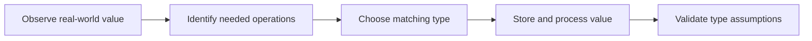

> **Level 1: Beginner** · Topic 6 of 35

[← Variables](./05-variables.md) · [↑ Level index](../README.md) · [Type Casting →](./07-type-casting.md)

# Data Types

## Overview
- **What is it?** A data type defines a value's representation, supported operations, and behavior.
- **Why is it important?** Choosing the right type prevents meaningless operations and models information accurately.
- **Where is it used?** Programs use numbers, booleans, text, collections, mappings, and `None` for missing values.

## Learning Objectives
- Identify common built-in types with `type` and `isinstance`.
- Select scalar or collection types that fit the data.
- Explain mutability and why it affects updates and sharing.

## Real World Applications
- Represent prices, labels, and yes/no flags.
- Group records in lists, tuples, sets, or dictionaries.
- Model an intentionally absent result with `None`.

## Core Concepts

### Scalar types
- **Definition:** `int`, `float`, `bool`, and `NoneType` represent individual numeric, logical, or absent values.
- **Visual explanation:** `value -> type -> allowed operations`
- **Practical example:** Different literal forms create different types.

```python
count = 3
rate = 1.5
active = True
print(type(count), type(rate), type(active))
```

### Collection types
- **Definition:** Lists and tuples are sequences, sets hold unique hashable values, and dictionaries map keys to values.
- **Visual explanation:** `many values -> sequence, set, or mapping`
- **Practical example:** One record uses a dictionary while tags use a set.

```python
course = {"title": "Python", "lessons": 35}
tags = {"beginner", "python"}
print(course["title"], tags)
```

### Mutability
- **Definition:** Mutable objects can change in place; immutable objects require a new value for any apparent update.
- **Visual explanation:** `list -> mutate same object; string -> create new string`
- **Practical example:** The list changes, while `upper` is a separate string.

```python
topics = ["syntax"]
topics.append("types")
name = "python"
upper = name.upper()
print(topics, name, upper)
```

## Infographic Summary

| Infographic Block | Topic-Specific Takeaway |
| --- | --- |
| 📌 Concept | A data type defines a value's representation, supported operations, and behavior. |
| ⚡ Purpose | Represent each kind of information with the operations and behavior it requires. |
| 🔥 Benefits | Choosing the right type prevents meaningless operations and models information accurately. |
| 🎯 Use Cases | Programs use numbers, booleans, text, collections, mappings, and `None` for missing values. |
| 🚀 Best Practices | Model meaning first, then select a type whose operations and mutability match that meaning. |
| ❌ Common Mistakes | Using a string for every value and discovering too late that numeric or boolean operations are needed. |

## Syntax Guide

### Basic Syntax

```python
age = 21
price = 9.99
is_open = False
name = "Kai"
```

### Standard Structure

```python
values = [42, 3.5, "answer", True, None]
for value in values:
    print(value, type(value).__name__)
```

### Code Pattern

```python
profile = {
    "name": "Kai",
    "scores": [88, 92],
    "skills": {"Python", "Git"},
}
print(isinstance(profile["scores"], list))
```

## Examples

### Beginner Example

```python
temperature = 23.5
print(type(temperature).__name__)
```

### Intermediate Example

```python
inventory = {"pens": 12, "notebooks": 5}
in_stock = inventory["pens"] > 0
print(in_stock)
```

### Advanced Example

```python
readings = [18.2, 19.1, 18.7]
summary = {
    "minimum": min(readings),
    "maximum": max(readings),
    "count": len(readings),
}
print(summary)
```

## Workflow Diagram



---

[← Variables](./05-variables.md) · [↑ Level index](../README.md) · [Type Casting →](./07-type-casting.md)
