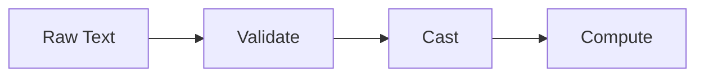

# Type Casting

## Overview

- **What is it?** Type casting converts values from one type to another explicitly.
- **Why is it important?** User input and file data arrive as strings; casting enables computation.
- **Where is it used?** Forms, CSV imports, query parameters, CLI arguments.

## Learning Objectives

- **Skills gained:** Practical command of Type Casting.
- **Concepts covered:**

- Use int(), float(), str(), and bool() safely.
- Handle invalid conversions with try/except.
- Understand truthiness when casting to bool.

- **Expected outcome:** You convert external data into usable Python types without silent errors.

## Real World Applications

- E-commerce checkout
- Spreadsheet ingestion
- Mobile backends
- Billing engines

- **Business applications:** Automate workflows, reduce manual errors, accelerate delivery.
- **Career relevance:** Required knowledge for Python roles from junior developer to senior engineer.

## Core Concepts

### int()

- **Definition:** Parse integers from numeric strings.
- **Visual explanation:** `int()` → process → result
- **Practical example:**

```python
qty = int('12')
print(qty + 1)
```

### float()

- **Definition:** Parse decimal numbers.
- **Visual explanation:** `float()` → process → result
- **Practical example:**

```python
rate = float('0.075')
print(rate * 100)
```

### str()

- **Definition:** Serialize values for display or files.
- **Visual explanation:** `str()` → process → result
- **Practical example:**

```python
label = str(404)
print('HTTP ' + label)
```

## Infographic Summary

| Block | Summary |
| --- | --- |
| 📌 Concept | Casting makes implicit string data explicit and computable. |
| ⚡ Purpose | Bridge human-readable input and program logic. |
| 🔥 Benefits | Correct math, valid comparisons, predictable formatting. |
| 🎯 Use Cases | Price calculations, age gates, ID formatting, logging. |
| 🚀 Best Practices | Validate before cast; strip whitespace; localize decimals carefully. |
| ❌ Common Mistakes | Casting invalid strings without error handling, using bool('0') incorrectly. |

## Syntax Guide

### Basic Syntax

```python
score = int('95')
print(score)
```

### Standard Structure

```python
read string -> validate -> cast -> use
```

### Code Pattern

```python
total = float('10.5') * int('2')
print(total)
```

## Examples

### Beginner Example

```python
age = int('21')
print(age >= 18)
```

### Intermediate Example

```python
def safe_int(text: str, default: int = 0) -> int:
    try:
        return int(text.strip())
    except ValueError:
        return default


print(safe_int(' 42 '))
```

### Advanced Example

```python
from decimal import Decimal

amount = Decimal('19.99')
tax = amount * Decimal('0.08')
print(amount + tax)
```

## Workflow Diagram



---
