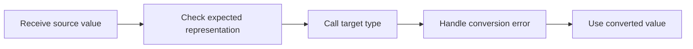

> **Level 1: Beginner** · Topic 7 of 35

[← Data Types](./06-data-types.md) · [↑ Level index](../README.md) · [Input and Output →](./08-input-and-output.md)

# Type Casting

## Overview
- **What is it?** Type casting explicitly converts a value to another type by calling constructors such as `int`, `float`, or `str`.
- **Why is it important?** Conversion turns text input and external data into forms suitable for calculation, comparison, or display.
- **Where is it used?** Forms, files, environment settings, and APIs commonly deliver values that need conversion.

## Learning Objectives
- Convert between compatible strings, numbers, and booleans.
- Recognize lossy conversions such as `int(3.9)`.
- Validate text before or while handling a failed conversion.

## Real World Applications
- Turn an entered quantity into an integer.
- Format numeric identifiers or totals as text.
- Normalize imported measurements before analysis.

## Core Concepts

### Constructor conversion
- **Definition:** Calling a built-in type creates a value of that type when the source representation is valid.
- **Visual explanation:** `"42" -> int -> 42`
- **Practical example:** Text representations become numeric values.

```python
whole = int("42")
price = float("7.50")
print(whole, price)
```

### Loss and representation
- **Definition:** Some conversions discard information or use formatting rules, so the target may not preserve the source exactly.
- **Visual explanation:** `3.9 -> int -> 3, not rounded 4`
- **Practical example:** Integer conversion truncates toward zero.

```python
measurement = 3.9
truncated = int(measurement)
print(truncated)
```

### Conversion failure
- **Definition:** Invalid representations raise `ValueError`; reliable programs catch it or reject the input.
- **Visual explanation:** `"many" -> int -> ValueError`
- **Practical example:** A helper returns `None` when text is not an integer.

```python
def parse_count(text):
    try:
        return int(text)
    except ValueError:
        return None

print(parse_count("12"), parse_count("many"))
```

## Infographic Summary

| Infographic Block | Topic-Specific Takeaway |
| --- | --- |
| 📌 Concept | Type casting explicitly converts a value to another type by calling constructors such as `int`, `float`, or `str`. |
| ⚡ Purpose | Convert values at data boundaries into the types required by calculations and comparisons. |
| 🔥 Benefits | Conversion turns text input and external data into forms suitable for calculation, comparison, or display. |
| 🎯 Use Cases | Forms, files, environment settings, and APIs commonly deliver values that need conversion. |
| 🚀 Best Practices | Convert at the system boundary, keep internal values typed consistently, and make failure behavior explicit. |
| ❌ Common Mistakes | Using `bool('False')` expecting `False`; every non-empty string is truthy. |

## Syntax Guide

### Basic Syntax

```python
count = int("8")
ratio = float("0.75")
label = str(2026)
```

### Standard Structure

```python
raw_price = "19.95"
quantity = 2
total = float(raw_price) * quantity
print(f"${total:.2f}")
```

### Code Pattern

```python
def parse_yes_no(text):
    normalized = text.strip().lower()
    if normalized in {"yes", "y"}:
        return True
    if normalized in {"no", "n"}:
        return False
    raise ValueError("Enter yes or no")

print(parse_yes_no(" Yes "))
```

## Examples

### Beginner Example

```python
year = int("2026")
print(year + 1)
```

### Intermediate Example

```python
values = ["4", "7", "11"]
numbers = [int(value) for value in values]
print(sum(numbers))
```

### Advanced Example

```python
def convert_temperature(text):
    try:
        celsius = float(text)
    except ValueError:
        return "Invalid temperature"
    fahrenheit = celsius * 9 / 5 + 32
    return f"{fahrenheit:.1f} F"

print(convert_temperature("21.5"))
```

## Workflow Diagram



---

[← Data Types](./06-data-types.md) · [↑ Level index](../README.md) · [Input and Output →](./08-input-and-output.md)
