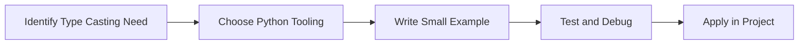

> **Level 1: Beginner** · Topic 7 of 35

[← Data Types](./06-data-types.md) · [↑ Level index](../README.md) · [Input and Output →](./08-input-and-output.md)

# Type Casting

## Overview
- **What is it?** Type casting converts values from one type to another, such as text to numbers.
- **Why is it important?** Normalize input before calculations, comparisons, or storage.
- **Where is it used?** Software teams, education, automation, analytics, and backend development.

## Learning Objectives
- Gain the practical skill to explain, write, debug, and review type casting code.
- Cover the vocabulary, syntax, workflow, edge cases, and professional habits behind type casting.
- Expected outcome: you can use type casting in a small project and recognize when it belongs in production code.

## Real World Applications
- **Industry use cases:** Software teams, education, automation, analytics, and backend development.
- **Business applications:** Reduce manual work, improve reliability, support reporting, automate decisions, and ship maintainable features.
- **Career relevance:** Supports Python developer, backend engineer, data engineer, AI engineer, DevOps engineer, QA automation, and cybersecurity automation roles.

## Core Concepts

### Mental Model
- **Definition:** The main idea that gives type casting its structure and purpose inside a Python program.
- **Visual explanation:** `problem -> Type Casting model -> clear code`
- **Practical example:**

```python
apply_type_casting_label = "Type Casting"
print(apply_type_casting_label)
```

### Execution Flow
- **Definition:** The ordered steps Python follows when type casting code is created, executed, or integrated.
- **Visual explanation:** `input -> Python operation -> result -> feedback`
- **Practical example:**

```python
age_text = "21"
age = int(age_text)
print(age + 1)
```

### Quality Rule
- **Definition:** The reliability habit that keeps type casting understandable, testable, secure, and maintainable.
- **Visual explanation:** `working code -> validation -> production confidence`
- **Practical example:**

```python
raw_values = ["10", "20", "30"]
values = [int(value) for value in raw_values]
print(sum(values))
```

## Infographic Summary

| Infographic Block | Key Message |
| --- | --- |
| 📌 Concept | Type Casting belongs to the core programming foundation part of Python mastery. |
| ⚡ Purpose | Normalize input before calculations, comparisons, or storage. |
| 🔥 Benefits | Safer forms, APIs, CLI tools, and data imports. |
| 🎯 Use Cases | Software teams, education, automation, analytics, and backend development. |
| 🚀 Best Practices | Prefer readable names, small examples, explicit errors, tests, documentation, and version-aware choices. |
| ❌ Common Mistakes | Copying code without understanding it, ignoring edge cases, skipping validation, and mixing unrelated responsibilities. |

## Syntax Guide

### Basic Syntax

```python
quantity = int("12")
price = float("9.99")
label = str(quantity)
```

### Standard Structure

```python
def apply_type_casting(value):
    """Apply the Type Casting concept to one value."""
    return value

result = apply_type_casting("practice")
print(result)
```

### Code Pattern

```python
# 1. Identify the Type Casting problem
# 2. Apply the correct Python structure
# 3. Validate the result with tests or output
```

## Examples

### Beginner Example

```python
age_text = "21"
age = int(age_text)
print(age + 1)
```

### Intermediate Example

```python
raw_values = ["10", "20", "30"]
values = [int(value) for value in raw_values]
print(sum(values))
```

### Advanced Example

```python
from decimal import Decimal

amount = Decimal("19.99")
tax = Decimal("0.08")
print((amount * (1 + tax)).quantize(Decimal("0.01")))
```

## Workflow Diagram




---

---

[← Data Types](./06-data-types.md) · [↑ Level index](../README.md) · [Input and Output →](./08-input-and-output.md)
