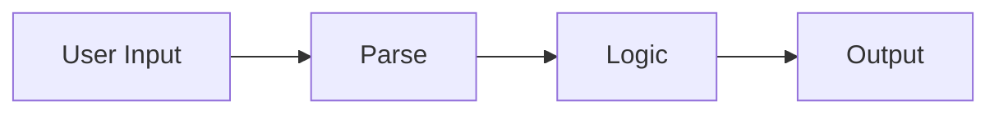

# Input and Output

## Overview

- **What is it?** Input and output (I/O) moves data between users, files, and programs.
- **Why is it important?** Most programs must read requests and emit responses or logs.
- **Where is it used?** CLIs, notebooks, web forms, batch jobs, interactive tools.

## Learning Objectives

- **Skills gained:** Practical command of Input and Output.
- **Concepts covered:**

- Read user input with input() and parse it.
- Write formatted output with print() and f-strings.
- Separate presentation from business logic.

- **Expected outcome:** You build interactive scripts with clear prompts and readable output.

## Real World Applications

- Customer support tools
- Internal ops scripts
- Education apps
- Kiosk systems

- **Business applications:** Automate workflows, reduce manual errors, accelerate delivery.
- **Career relevance:** Required knowledge for Python roles from junior developer to senior engineer.

## Core Concepts

### input()

- **Definition:** Reads a line of text from stdin.
- **Visual explanation:** `input()` → process → result
- **Practical example:**

```python
name = 'Ada'
print(name.upper())
```

### print()

- **Definition:** Writes text to stdout.
- **Visual explanation:** `print()` → process → result
- **Practical example:**

```python
print('Done', flush=True)
```

### f-strings

- **Definition:** Embed expressions in strings.
- **Visual explanation:** `f-strings` → process → result
- **Practical example:**

```python
name = 'Ada'
print(f'Hello, {name}!')
```

## Infographic Summary

| Block | Summary |
| --- | --- |
| 📌 Concept | I/O is the boundary between humans and your Python logic. |
| ⚡ Purpose | Collect parameters and communicate results. |
| 🔥 Benefits | Better UX, testable interfaces, scriptable workflows. |
| 🎯 Use Cases | Quizzes, calculators, menu-driven tools, quick prototypes. |
| 🚀 Best Practices | Prompt clearly, validate input, avoid mixing logic with formatting. |
| ❌ Common Mistakes | Trusting raw input, printing secrets, no newline control in logs. |

## Syntax Guide

### Basic Syntax

```python
name = 'World'
print(f'Hi, {name}')
```

### Standard Structure

```python
prompt -> read -> validate -> process -> display
```

### Code Pattern

```python
value = '7'
print(int(value) ** 2)
```

## Examples

### Beginner Example

```python
name = 'World'
print(f'Hi, {name}')
```

### Intermediate Example

```python
def ask_yes_no(prompt: str) -> bool:
    answer = 'yes'
    return answer in {'y', 'yes'}


print(ask_yes_no('Continue?'))
```

### Advanced Example

```python
import sys

data = 'hello world'
sys.stdout.write(data.upper() + '\n')
```

## Workflow Diagram



---
