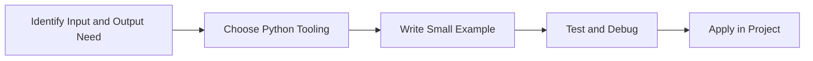

> **Level 1: Beginner** · Topic 8 of 35

[← Type Casting](./07-type-casting.md) · [↑ Level index](../README.md) · [Operators →](./09-operators.md)

# Input and Output

## Overview
- **What is it?** Input and output move data into and out of programs through keyboards, files, streams, APIs, and terminals.
- **Why is it important?** Let programs interact with users and external systems.
- **Where is it used?** Software teams, education, automation, analytics, and backend development.

## Learning Objectives
- Gain the practical skill to explain, write, debug, and review input and output code.
- Cover the vocabulary, syntax, workflow, edge cases, and professional habits behind input and output.
- Expected outcome: you can use input and output in a small project and recognize when it belongs in production code.

## Real World Applications
- **Industry use cases:** Software teams, education, automation, analytics, and backend development.
- **Business applications:** Reduce manual work, improve reliability, support reporting, automate decisions, and ship maintainable features.
- **Career relevance:** Supports Python developer, backend engineer, data engineer, AI engineer, DevOps engineer, QA automation, and cybersecurity automation roles.

## Core Concepts

### Mental Model
- **Definition:** The main idea that gives input and output its structure and purpose inside a Python program.
- **Visual explanation:** `problem -> Input and Output model -> clear code`
- **Practical example:**

```python
apply_input_and_output_label = "Input and Output"
print(apply_input_and_output_label)
```

### Execution Flow
- **Definition:** The ordered steps Python follows when input and output code is created, executed, or integrated.
- **Visual explanation:** `input -> Python operation -> result -> feedback`
- **Practical example:**

```python
name = "Learner"
print(f"Welcome, {name}!")
```

### Quality Rule
- **Definition:** The reliability habit that keeps input and output understandable, testable, secure, and maintainable.
- **Visual explanation:** `working code -> validation -> production confidence`
- **Practical example:**

```python
def render_invoice(customer: str, total: float) -> str:
    return f"Invoice for {customer}: ${total:.2f}"

print(render_invoice("Ada", 125.5))
```

## Infographic Summary

| Infographic Block | Key Message |
| --- | --- |
| 📌 Concept | Input and Output belongs to the core programming foundation part of Python mastery. |
| ⚡ Purpose | Let programs interact with users and external systems. |
| 🔥 Benefits | Useful scripts, reports, automation, and command-line tools. |
| 🎯 Use Cases | Software teams, education, automation, analytics, and backend development. |
| 🚀 Best Practices | Prefer readable names, small examples, explicit errors, tests, documentation, and version-aware choices. |
| ❌ Common Mistakes | Copying code without understanding it, ignoring edge cases, skipping validation, and mixing unrelated responsibilities. |

## Syntax Guide

### Basic Syntax

```python
name = input("Name: ")
print(f"Hello, {name}")
```

### Standard Structure

```python
def apply_input_and_output(value):
    """Apply the Input and Output concept to one value."""
    return value

result = apply_input_and_output("practice")
print(result)
```

### Code Pattern

```python
# 1. Identify the Input and Output problem
# 2. Apply the correct Python structure
# 3. Validate the result with tests or output
```

## Examples

### Beginner Example

```python
name = "Learner"
print(f"Welcome, {name}!")
```

### Intermediate Example

```python
def render_invoice(customer: str, total: float) -> str:
    return f"Invoice for {customer}: ${total:.2f}"

print(render_invoice("Ada", 125.5))
```

### Advanced Example

```python
import sys

sys.stdout.write("streamed output\n")
sys.stderr.write("diagnostic output\n")
```

## Workflow Diagram




---

---

[← Type Casting](./07-type-casting.md) · [↑ Level index](../README.md) · [Operators →](./09-operators.md)
