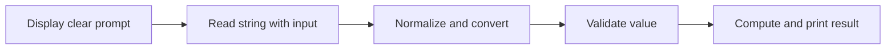

> **Level 1: Beginner** · Topic 8 of 35

[← Type Casting](./07-type-casting.md) · [↑ Level index](../README.md) · [Operators →](./09-operators.md)

# Input and Output

## Overview
- **What is it?** Input and output move information between a program and users or external streams; `input()` reads terminal text and `print()` writes display text.
- **Why is it important?** Interaction makes a program responsive, but entered text must be converted and validated before use.
- **Where is it used?** Command-line tools, questionnaires, games, and administrative scripts all use terminal I/O.

## Learning Objectives
- Read text with `input` and display values with `print`.
- Convert and validate user input before calculation.
- Separate interaction from calculation so logic remains testable.

## Real World Applications
- Collect a user's name or menu choice.
- Display a formatted receipt or progress report.
- Build a small command-line calculator or questionnaire.

## Core Concepts

### Reading input
- **Definition:** `input(prompt)` displays a prompt, waits for a line, removes the trailing newline, and always returns a string.
- **Visual explanation:** `keyboard text -> input -> str`
- **Practical example:**

```python
name = input("Name: ")
print(f"Hello, {name}!")
```

### Producing output
- **Definition:** `print` converts objects to text and writes them to standard output with configurable separators and endings.
- **Visual explanation:** `values -> string conversion -> stdout`
- **Practical example:**

```python
item = "notebook"
price = 4.5
print(item, price, sep=": $")
```

### Boundary validation
- **Definition:** Interactive text should be normalized, converted, and checked before business logic consumes it.
- **Visual explanation:** `raw input -> strip -> convert -> validate -> calculate`
- **Practical example:**

```python
raw = input("Quantity: ")
try:
    quantity = int(raw)
    print("Accepted:", quantity) if quantity > 0 else print("Must be positive")
except ValueError:
    print("Enter a whole number")
```

## Infographic Summary

| Infographic Block | Topic-Specific Takeaway |
| --- | --- |
| 📌 Concept | Input and output move information between a program and users or external streams; `input()` reads terminal text and `print()` writes display text. |
| ⚡ Purpose | Exchange text with users through prompts and clearly formatted terminal output. |
| 🔥 Benefits | Interaction makes a program responsive, but entered text must be converted and validated before use. |
| 🎯 Use Cases | Command-line tools, questionnaires, games, and administrative scripts all use terminal I/O. |
| 🚀 Best Practices | Keep `input` and `print` at the edge of the program; pass clean values into functions that compute results. |
| ❌ Common Mistakes | Performing arithmetic directly on `input()` results without converting the returned strings. |

## Syntax Guide

### Basic Syntax

```python
answer = input("Favorite color: ")
print("You chose", answer)
```

### Standard Structure

```python
name = input("Name: ").strip()
age = int(input("Age: "))
print(f"{name} will be {age + 1} next year.")
```

### Code Pattern

```python
def calculate_total(price, quantity):
    return price * quantity

price = float(input("Unit price: "))
quantity = int(input("Quantity: "))
print(f"Total: ${calculate_total(price, quantity):.2f}")
```

## Examples

### Beginner Example

```python
city = input("City: ")
print(f"Weather lookup requested for {city}.")
```

### Intermediate Example

```python
raw_score = input("Score from 0 to 100: ")
score = int(raw_score)
if 0 <= score <= 100:
    print(f"Recorded: {score}")
else:
    print("Score out of range")
```

### Advanced Example

```python
def prompt_positive_integer(prompt):
    while True:
        raw = input(prompt).strip()
        try:
            value = int(raw)
        except ValueError:
            print("Use digits only.")
            continue
        if value > 0:
            return value
        print("Value must be positive.")

seats = prompt_positive_integer("Seats: ")
print(f"Reserved {seats} seat(s).")
```

## Workflow Diagram



---

[← Type Casting](./07-type-casting.md) · [↑ Level index](../README.md) · [Operators →](./09-operators.md)
