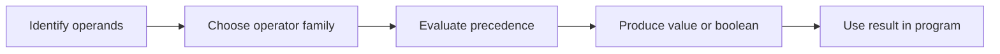

> **Level 1: Beginner** · Topic 9 of 35

[← Input and Output](./08-input-and-output.md) · [↑ Level index](../README.md) · [Conditional Statements →](./10-conditional-statements.md)

# Operators

## Overview
- **What is it?** Operators are symbols or keywords that perform arithmetic, comparison, logical, assignment, membership, and identity operations.
- **Why is it important?** Operator families form expressions that calculate values and decide which code paths apply.
- **Where is it used?** Pricing, filtering, validation, search, and state updates all depend on operators.

## Learning Objectives
- Use arithmetic and assignment operators correctly.
- Combine comparison, logical, and membership operators into conditions.
- Distinguish equality `==` from identity `is` and apply precedence deliberately.

## Real World Applications
- Calculate totals, remainders, and powers.
- Check ranges and combine eligibility rules.
- Test collection membership or whether a value is `None`.

## Core Concepts

### Arithmetic and assignment
- **Definition:** Arithmetic operators compute numbers; assignment forms such as `+=` bind the updated result to a name.
- **Visual explanation:** `operands -> + - * / // % ** -> result`
- **Practical example:**

```python
subtotal = 17 * 3
remainder = 17 % 3
subtotal += 5
print(subtotal, remainder)
```

### Comparison and logic
- **Definition:** Comparisons produce booleans; `and`, `or`, and `not` combine or invert truth conditions.
- **Visual explanation:** `comparisons -> booleans -> logical result`
- **Practical example:**

```python
age = 20
has_ticket = True
can_enter = age >= 18 and has_ticket
print(can_enter)
```

### Membership and identity
- **Definition:** `in` searches for membership, while `is` checks whether two references point to the same object.
- **Visual explanation:** `value in container; name is singleton`
- **Practical example:**

```python
roles = {"editor", "viewer"}
role = "editor"
selection = None
print(role in roles, selection is None)
```

## Infographic Summary

| Infographic Block | Topic-Specific Takeaway |
| --- | --- |
| 📌 Concept | Operators are symbols or keywords that perform arithmetic, comparison, logical, assignment, membership, and identity operations. |
| ⚡ Purpose | Build expressions that calculate, compare, combine, assign, and test values. |
| 🔥 Benefits | Operator families form expressions that calculate values and decide which code paths apply. |
| 🎯 Use Cases | Pricing, filtering, validation, search, and state updates all depend on operators. |
| 🚀 Best Practices | Use parentheses when mixed operator precedence could make the intended grouping unclear. |
| ❌ Common Mistakes | Using `is` for value equality; use `==` for equal values and reserve `is` for identity, especially `None`. |

## Syntax Guide

### Basic Syntax

```python
a = 11
b = 4
print(a + b, a - b, a * b, a / b, a // b, a % b, a ** 2)
```

### Standard Structure

```python
score = 84
passed = score >= 60
honors = passed and score >= 90
print(passed, honors)
```

### Code Pattern

```python
allowed_roles = {"admin", "editor"}
user_role = "editor"
account_active = True
authorized = account_active and user_role in allowed_roles
print(authorized)
```

## Examples

### Beginner Example

```python
price = 15
quantity = 3
print(price * quantity)
```

### Intermediate Example

```python
temperature = 24
comfortable = 18 <= temperature <= 26
print("Comfortable:", comfortable)
```

### Advanced Example

```python
cart_total = 82
is_member = False
coupon = "SAVE10"
discounted = (cart_total >= 75 or is_member) and coupon == "SAVE10"
final_total = cart_total * 0.9 if discounted else cart_total
print(f"${final_total:.2f}")
```

## Workflow Diagram



---

[← Input and Output](./08-input-and-output.md) · [↑ Level index](../README.md) · [Conditional Statements →](./10-conditional-statements.md)
