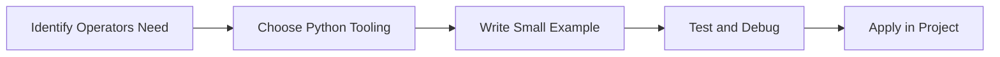

> **Level 1: Beginner** · Topic 9 of 35

[← Input and Output](./08-input-and-output.md) · [↑ Level index](../README.md) · [Conditional Statements →](./10-conditional-statements.md)

# Operators

## Overview
- **What is it?** Operators are symbols and keywords that combine, compare, and transform values.
- **Why is it important?** Build expressions for calculations and decisions.
- **Where is it used?** Software teams, education, automation, analytics, and backend development.

## Learning Objectives
- Gain the practical skill to explain, write, debug, and review operators code.
- Cover the vocabulary, syntax, workflow, edge cases, and professional habits behind operators.
- Expected outcome: you can use operators in a small project and recognize when it belongs in production code.

## Real World Applications
- **Industry use cases:** Software teams, education, automation, analytics, and backend development.
- **Business applications:** Reduce manual work, improve reliability, support reporting, automate decisions, and ship maintainable features.
- **Career relevance:** Supports Python developer, backend engineer, data engineer, AI engineer, DevOps engineer, QA automation, and cybersecurity automation roles.

## Core Concepts

### Mental Model
- **Definition:** The main idea that gives operators its structure and purpose inside a Python program.
- **Visual explanation:** `problem -> Operators model -> clear code`
- **Practical example:**

```python
apply_operators_label = "Operators"
print(apply_operators_label)
```

### Execution Flow
- **Definition:** The ordered steps Python follows when operators code is created, executed, or integrated.
- **Visual explanation:** `input -> Python operation -> result -> feedback`
- **Practical example:**

```python
score = 10
print(score)
```

### Quality Rule
- **Definition:** The reliability habit that keeps operators understandable, testable, secure, and maintainable.
- **Visual explanation:** `working code -> validation -> production confidence`
- **Practical example:**

```python
price = 120
discount_rate = 0.15
final_price = price * (1 - discount_rate)
print(final_price)
```

## Infographic Summary

| Infographic Block | Key Message |
| --- | --- |
| 📌 Concept | Operators belongs to the core programming foundation part of Python mastery. |
| ⚡ Purpose | Build expressions for calculations and decisions. |
| 🔥 Benefits | Concise business rules, filters, and computations. |
| 🎯 Use Cases | Software teams, education, automation, analytics, and backend development. |
| 🚀 Best Practices | Prefer readable names, small examples, explicit errors, tests, documentation, and version-aware choices. |
| ❌ Common Mistakes | Copying code without understanding it, ignoring edge cases, skipping validation, and mixing unrelated responsibilities. |

## Syntax Guide

### Basic Syntax

```python
customer_name = "Amina"
order_total = 149.50
is_paid = False
```

### Standard Structure

```python
def apply_operators(value):
    """Apply the Operators concept to one value."""
    return value

result = apply_operators("practice")
print(result)
```

### Code Pattern

```python
# 1. Identify the Operators problem
# 2. Apply the correct Python structure
# 3. Validate the result with tests or output
```

## Examples

### Beginner Example

```python
score = 10
print(score)
```

### Intermediate Example

```python
price = 120
discount_rate = 0.15
final_price = price * (1 - discount_rate)
print(final_price)
```

### Advanced Example

```python
from dataclasses import dataclass

@dataclass(frozen=True)
class Metric:
    name: str
    value: float

conversion_rate = Metric("conversion_rate", 0.084)
print(conversion_rate)
```

## Workflow Diagram




---

---

[← Input and Output](./08-input-and-output.md) · [↑ Level index](../README.md) · [Conditional Statements →](./10-conditional-statements.md)
