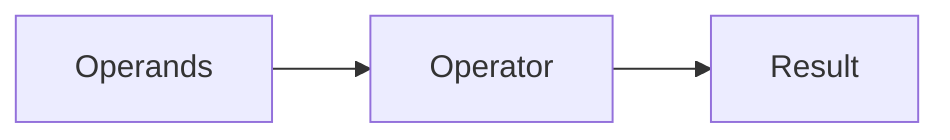

# Operators

## Overview

- **What is it?** Operators perform arithmetic, comparison, logical, and assignment actions on values.
- **Why is it important?** They express business rules compactly in conditions and expressions.
- **Where is it used?** Pricing, eligibility checks, scoring, game mechanics, data filters.

## Learning Objectives

- **Skills gained:** Practical command of Operators.
- **Concepts covered:**

- Apply arithmetic and comparison operators.
- Combine conditions with and, or, not.
- Use augmented assignment for updates.

- **Expected outcome:** You write expressive conditions and calculations without verbose code.

## Real World Applications

- Retail pricing
- Risk scoring
- Games
- Monitoring alerts

- **Business applications:** Automate workflows, reduce manual errors, accelerate delivery.
- **Career relevance:** Required knowledge for Python roles from junior developer to senior engineer.

## Core Concepts

### Arithmetic

- **Definition:** + - * / // % ** on numbers.
- **Visual explanation:** `Arithmetic` → process → result
- **Practical example:**

```python
total = 10 + 5 * 2
print(total)
```

### Comparison

- **Definition:** Return booleans for ordering/equality.
- **Visual explanation:** `Comparison` → process → result
- **Practical example:**

```python
print(3 >= 2 and 4 != 5)
```

### Augmented assignment

- **Definition:** Update variables in place.
- **Visual explanation:** `Augmented assignment` → process → result
- **Practical example:**

```python
count = 0
count += 1
print(count)
```

## Infographic Summary

| Block | Summary |
| --- | --- |
| 📌 Concept | Operators combine values into new results or decisions. |
| ⚡ Purpose | Implement rules and transformations inline. |
| 🔥 Benefits | Readable logic, fewer temporary variables. |
| 🎯 Use Cases | Tax calculation, access control, sorting keys, thresholds. |
| 🚀 Best Practices | Use parentheses for clarity; avoid chaining confusing comparisons. |
| ❌ Common Mistakes | Operator precedence mistakes, using is for value equality, division surprises. |

## Syntax Guide

### Basic Syntax

```python
a, b = 10, 3
print(a // b, a % b)
```

### Standard Structure

```python
operands -> operator -> result -> use in condition
```

### Code Pattern

```python
eligible = age >= 18 and country == 'US'
print(eligible)
```

## Examples

### Beginner Example

```python
price = 100
discount = price * 0.1
print(price - discount)
```

### Intermediate Example

```python
scores = [88, 92, 76]
average = sum(scores) / len(scores)
passed = average >= 80
print(average, passed)
```

### Advanced Example

```python
from operator import itemgetter

rows = [{'n': 'Ada', 's': 95}, {'n': 'Lin', 's': 88}]
top = max(rows, key=itemgetter('s'))
print(top)
```

## Workflow Diagram



---
