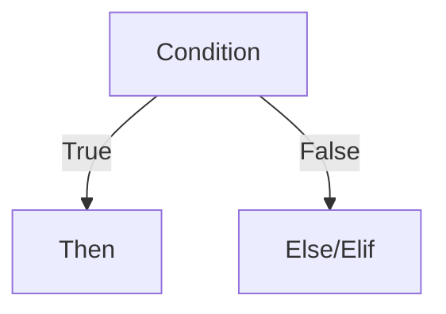

# Conditional Statements

## Overview

- **What is it?** Conditional statements execute code selectively with if, elif, and else.
- **Why is it important?** Business logic depends on branching based on data and state.
- **Where is it used?** Auth checks, feature flags, error paths, pricing tiers.

## Learning Objectives

- **Skills gained:** Practical command of Conditional Statements.
- **Concepts covered:**

- Write if/elif/else chains for multiple cases.
- Nest conditions sparingly with clear structure.
- Use ternary expressions for simple assignments.

- **Expected outcome:** You implement decision trees that are easy to read and test.

## Real World Applications

- Access control
- Billing rules
- Workflow engines
- Support triage

- **Business applications:** Automate workflows, reduce manual errors, accelerate delivery.
- **Career relevance:** Required knowledge for Python roles from junior developer to senior engineer.

## Core Concepts

### if

- **Definition:** Runs block when condition is truthy.
- **Visual explanation:** `if` → process → result
- **Practical example:**

```python
if score >= 60:
    print('pass')
```

### elif

- **Definition:** Tests additional conditions.
- **Visual explanation:** `elif` → process → result
- **Practical example:**

```python
x = -1
if x > 0:
    sign = 'pos'
elif x < 0:
    sign = 'neg'
else:
    sign = 'zero'
print(sign)
```

### else

- **Definition:** Fallback when no condition matches.
- **Visual explanation:** `else` → process → result
- **Practical example:**

```python
logged_in = False
print('home' if logged_in else 'login')
```

## Infographic Summary

| Block | Summary |
| --- | --- |
| 📌 Concept | Conditionals map inputs to different behaviors. |
| ⚡ Purpose | Encode policies and validations. |
| 🔥 Benefits | Explicit paths, fewer duplicated checks, testable branches. |
| 🎯 Use Cases | Login flows, shipping methods, grading, alert severity. |
| 🚀 Best Practices | Prefer flat elif chains; extract complex tests to functions. |
| ❌ Common Mistakes | Deep nesting, duplicate conditions, assignment inside if by mistake. |

## Syntax Guide

### Basic Syntax

```python
if temperature > 30:
    print('hot')
```

### Standard Structure

```python
guard clauses -> main branches -> else fallback
```

### Code Pattern

```python
status = 'gold' if points >= 1000 else 'silver'
```

## Examples

### Beginner Example

```python
score = 74
if score >= 90:
    grade = 'A'
elif score >= 80:
    grade = 'B'
else:
    grade = 'C'
print(grade)
```

### Intermediate Example

```python
def shipping_fee(weight_kg: float) -> float:
    if weight_kg <= 1:
        return 5.0
    if weight_kg <= 5:
        return 9.0
    return 15.0


print(shipping_fee(3.2))
```

### Advanced Example

```python
from enum import Enum


class Role(str, Enum):
    ADMIN = 'admin'
    USER = 'user'


def can_delete(role: Role) -> bool:
    return role is Role.ADMIN


print(can_delete(Role.USER))
```

## Workflow Diagram



---
