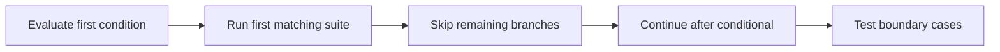

> **Level 1: Beginner** · Topic 10 of 35

[← Operators](./09-operators.md) · [↑ Level index](../README.md) · [Loops →](./11-loops.md)

# Conditional Statements

## Overview
- **What is it?** Conditional statements select a code block according to boolean conditions using `if`, `elif`, and `else`.
- **Why is it important?** Branching translates rules and alternative outcomes into executable control flow.
- **Where is it used?** Programs use conditions for permissions, grading, validation, pricing, and status messages.

## Learning Objectives
- Write mutually exclusive `if`/`elif`/`else` branches.
- Order conditions from specific to general.
- Use truth values without unnecessary comparisons to `True`.

## Real World Applications
- Classify a score or measurement.
- Allow or reject an action based on policy.
- Choose discounts, shipping tiers, or status labels.

## Core Concepts

### Boolean branch
- **Definition:** An `if` suite runs only when its condition is truthy.
- **Visual explanation:** `condition true -> run suite; false -> skip`
- **Practical example:**

```python
balance = 40
if balance > 0:
    print("Funds available")
```

### Exclusive chain
- **Definition:** In an `if`/`elif`/`else` chain, Python runs the first true branch and skips the rest.
- **Visual explanation:** `test top to bottom -> first match -> exit chain`
- **Practical example:**

```python
score = 78
if score >= 90:
    grade = "A"
elif score >= 70:
    grade = "B"
else:
    grade = "C"
print(grade)
```

### Guard condition
- **Definition:** A guard handles an invalid or exceptional case early so the normal path stays simple.
- **Visual explanation:** `invalid? -> reject; otherwise -> continue`
- **Practical example:**

```python
def safe_average(total, count):
    if count == 0:
        return None
    return total / count

print(safe_average(42, 6))
```

## Infographic Summary

| Infographic Block | Topic-Specific Takeaway |
| --- | --- |
| 📌 Concept | Conditional statements select a code block according to boolean conditions using `if`, `elif`, and `else`. |
| ⚡ Purpose | Select exactly which block should run for the current conditions. |
| 🔥 Benefits | Branching translates rules and alternative outcomes into executable control flow. |
| 🎯 Use Cases | Programs use conditions for permissions, grading, validation, pricing, and status messages. |
| 🚀 Best Practices | Make branches exhaustive when every input needs an outcome, and test values at each boundary. |
| ❌ Common Mistakes | Placing a broad condition before a more specific one, making the later branch unreachable. |

## Syntax Guide

### Basic Syntax

```python
temperature = 12
if temperature < 15:
    print("Wear a coat")
```

### Standard Structure

```python
hours = 17
if hours < 12:
    greeting = "Good morning"
elif hours < 18:
    greeting = "Good afternoon"
else:
    greeting = "Good evening"
print(greeting)
```

### Code Pattern

```python
def shipping_band(weight, express):
    if weight <= 0:
        return "invalid"
    if express and weight <= 5:
        return "express-small"
    if weight <= 20:
        return "standard"
    return "freight"

print(shipping_band(4, True))
```

## Examples

### Beginner Example

```python
logged_in = True
if logged_in:
    print("Dashboard ready")
```

### Intermediate Example

```python
purchase = 120
if purchase >= 100:
    discount = 0.15
elif purchase >= 50:
    discount = 0.05
else:
    discount = 0
print(purchase * (1 - discount))
```

### Advanced Example

```python
def access_level(age, verified, suspended):
    if suspended:
        return "blocked"
    if not verified:
        return "verify account"
    if age >= 18:
        return "full access"
    return "limited access"

print(access_level(20, True, False))
```

## Workflow Diagram



---

[← Operators](./09-operators.md) · [↑ Level index](../README.md) · [Loops →](./11-loops.md)
