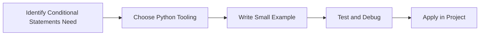

> **Level 1: Beginner** · Topic 10 of 35

[← Operators](./09-operators.md) · [↑ Level index](../README.md) · [Loops →](./11-loops.md)

# Conditional Statements

## Overview
- **What is it?** Conditional statements run different code paths based on boolean conditions.
- **Why is it important?** Represent decisions and branching business rules.
- **Where is it used?** Software teams, education, automation, analytics, and backend development.

## Learning Objectives
- Gain the practical skill to explain, write, debug, and review conditional statements code.
- Cover the vocabulary, syntax, workflow, edge cases, and professional habits behind conditional statements.
- Expected outcome: you can use conditional statements in a small project and recognize when it belongs in production code.

## Real World Applications
- **Industry use cases:** Software teams, education, automation, analytics, and backend development.
- **Business applications:** Reduce manual work, improve reliability, support reporting, automate decisions, and ship maintainable features.
- **Career relevance:** Supports Python developer, backend engineer, data engineer, AI engineer, DevOps engineer, QA automation, and cybersecurity automation roles.

## Core Concepts

### Mental Model
- **Definition:** The main idea that gives conditional statements its structure and purpose inside a Python program.
- **Visual explanation:** `problem -> Conditional Statements model -> clear code`
- **Practical example:**

```python
apply_conditional_statements_label = "Conditional Statements"
print(apply_conditional_statements_label)
```

### Execution Flow
- **Definition:** The ordered steps Python follows when conditional statements code is created, executed, or integrated.
- **Visual explanation:** `input -> Python operation -> result -> feedback`
- **Practical example:**

```python
score = 82
if score >= 60:
    print("Pass")
```

### Quality Rule
- **Definition:** The reliability habit that keeps conditional statements understandable, testable, secure, and maintainable.
- **Visual explanation:** `working code -> validation -> production confidence`
- **Practical example:**

```python
role = "admin"
can_delete = role in {"admin", "owner"}
print(can_delete)
```

## Infographic Summary

| Infographic Block | Key Message |
| --- | --- |
| 📌 Concept | Conditional Statements belongs to the core programming foundation part of Python mastery. |
| ⚡ Purpose | Represent decisions and branching business rules. |
| 🔥 Benefits | Validation, authorization, routing, and error handling. |
| 🎯 Use Cases | Software teams, education, automation, analytics, and backend development. |
| 🚀 Best Practices | Prefer readable names, small examples, explicit errors, tests, documentation, and version-aware choices. |
| ❌ Common Mistakes | Copying code without understanding it, ignoring edge cases, skipping validation, and mixing unrelated responsibilities. |

## Syntax Guide

### Basic Syntax

```python
if temperature > 30:
    print("Hot")
elif temperature > 20:
    print("Warm")
else:
    print("Cool")
```

### Standard Structure

```python
def apply_conditional_statements(value):
    """Apply the Conditional Statements concept to one value."""
    return value

result = apply_conditional_statements("practice")
print(result)
```

### Code Pattern

```python
# 1. Identify the Conditional Statements problem
# 2. Apply the correct Python structure
# 3. Validate the result with tests or output
```

## Examples

### Beginner Example

```python
score = 82
if score >= 60:
    print("Pass")
```

### Intermediate Example

```python
role = "admin"
can_delete = role in {"admin", "owner"}
print(can_delete)
```

### Advanced Example

```python
def classify_order(total: float, is_priority: bool) -> str:
    match (total >= 500, is_priority):
        case (True, True):
            return "vip-priority"
        case (True, False):
            return "vip"
        case _:
            return "standard"

print(classify_order(700, True))
```

## Workflow Diagram




---

---

[← Operators](./09-operators.md) · [↑ Level index](../README.md) · [Loops →](./11-loops.md)
