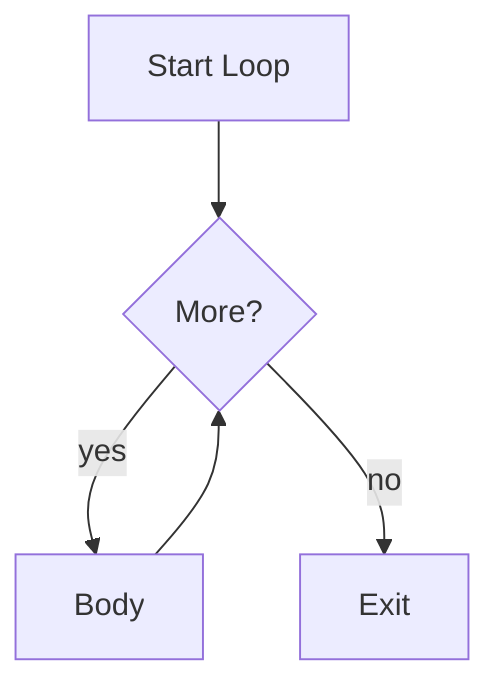

# Loops

## Overview

- **What is it?** Loops repeat blocks of code while a condition holds or over a sequence.
- **Why is it important?** Iteration processes collections and repeated tasks without duplication.
- **Where is it used?** Batch processing, reports, games, polling, data pipelines.

## Learning Objectives

- **Skills gained:** Practical command of Loops.
- **Concepts covered:**

- Use for and while loops appropriately.
- Iterate sequences and ranges.
- Avoid infinite loops.

- **Expected outcome:** You process collections and repeated work with clear loop constructs.

## Real World Applications

- Report generation
- Game loops
- IoT sampling
- Finance batch jobs

- **Business applications:** Automate workflows, reduce manual errors, accelerate delivery.
- **Career relevance:** Required knowledge for Python roles from junior developer to senior engineer.

## Core Concepts

### for

- **Definition:** Iterate over iterable objects.
- **Visual explanation:** `for` → process → result
- **Practical example:**

```python
for ch in 'abc':
    print(ch)
```

### while

- **Definition:** Repeat while condition is true.
- **Visual explanation:** `while` → process → result
- **Practical example:**

```python
n = 3
while n:
    n -= 1
    print(n)
```

### range

- **Definition:** Generate arithmetic progressions.
- **Visual explanation:** `range` → process → result
- **Practical example:**

```python
for i in range(3):
    print(i)
```

## Infographic Summary

| Block | Summary |
| --- | --- |
| 📌 Concept | Loops automate repetition with controlled exit conditions. |
| ⚡ Purpose | Traverse data and repeat operations efficiently. |
| 🔥 Benefits | Less duplication, scalable processing, idiomatic Python. |
| 🎯 Use Cases | Summing lists, retry logic, parsing lines, animations. |
| 🚀 Best Practices | Prefer for over while when iterating sequences; use enumerate when needed. |
| ❌ Common Mistakes | Off-by-one errors, modifying list while iterating, unbounded while True without break. |

## Syntax Guide

### Basic Syntax

```python
for item in items:
    print(item)
```

### Standard Structure

```python
init -> loop header -> body -> next item
```

### Code Pattern

```python
for row in rows:
    print(row)
```

## Examples

### Beginner Example

```python
for i in range(5):
    print(i * i)
```

### Intermediate Example

```python
total = 0
for value in [1, 2, 3, 4]:
    total += value
print(total)
```

### Advanced Example

```python
for index, name in enumerate(['Ada', 'Grace'], start=1):
    print(index, name)
```

## Workflow Diagram



---
