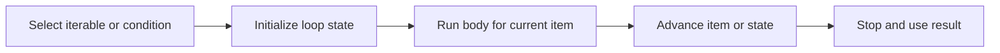

> **Level 1: Beginner** · Topic 11 of 35

[← Conditional Statements](./10-conditional-statements.md) · [↑ Level index](../README.md) · [Nested Loops →](./12-nested-loops.md)

# Loops

## Overview
- **What is it?** Loops repeat a block: `for` consumes items from an iterable, while `while` repeats while a condition remains true.
- **Why is it important?** Iteration processes collections and repeated state changes without copied statements.
- **Where is it used?** Loops drive batch processing, searches, counters, polling, and report generation.

## Learning Objectives
- Iterate over sequences and numeric ranges with `for`.
- Write a terminating `while` loop with an explicit state update.
- Use `enumerate`, accumulators, and loop `else` where appropriate.

## Real World Applications
- Calculate totals from many records.
- Repeat prompts until input is valid.
- Transform or inspect every item in a collection.

## Core Concepts

### For iteration
- **Definition:** A `for` loop requests each item from an iterable and binds it to the loop variable.
- **Visual explanation:** `iterable -> next item -> suite -> next item`
- **Practical example:**

```python
for language in ["Python", "SQL", "Git"]:
    print(language)
```

### While repetition
- **Definition:** A `while` loop checks its condition before every iteration and stops when it becomes false.
- **Visual explanation:** `check condition -> suite -> update -> check again`
- **Practical example:**

```python
countdown = 3
while countdown > 0:
    print(countdown)
    countdown -= 1
```

### Accumulation
- **Definition:** An accumulator starts with an identity value and is updated once per item.
- **Visual explanation:** `initial total -> add item repeatedly -> final total`
- **Practical example:**

```python
total = 0
for amount in [12, 7, 9]:
    total += amount
print(total)
```

## Infographic Summary

| Infographic Block | Topic-Specific Takeaway |
| --- | --- |
| 📌 Concept | Loops repeat a block: `for` consumes items from an iterable, while `while` repeats while a condition remains true. |
| ⚡ Purpose | Repeat work across an iterable or while a condition remains true. |
| 🔥 Benefits | Iteration processes collections and repeated state changes without copied statements. |
| 🎯 Use Cases | Loops drive batch processing, searches, counters, polling, and report generation. |
| 🚀 Best Practices | Choose `for` for a finite iterable and `while` for condition-driven repetition; prove how the loop terminates. |
| ❌ Common Mistakes | Writing a `while` condition whose controlling value never changes, creating an accidental infinite loop. |

## Syntax Guide

### Basic Syntax

```python
for number in range(1, 4):
    print(number)
```

### Standard Structure

```python
total = 0
for price in [5.0, 2.5, 8.0]:
    total += price
print(f"${total:.2f}")
```

### Code Pattern

```python
attempts = 3
while attempts > 0:
    password = "demo" if attempts == 1 else "wrong"
    if password == "demo":
        print("Access granted")
        break
    attempts -= 1
else:
    print("Locked out")
```

## Examples

### Beginner Example

```python
for letter in "Python":
    print(letter)
```

### Intermediate Example

```python
scores = [72, 95, 81]
for position, score in enumerate(scores, start=1):
    print(position, score)
```

### Advanced Example

```python
transactions = [25, -8, 13, -4]
balance = 0
for transaction in transactions:
    balance += transaction
    status = "credit" if transaction >= 0 else "debit"
    print(status, transaction, balance)
```

## Workflow Diagram



---

[← Conditional Statements](./10-conditional-statements.md) · [↑ Level index](../README.md) · [Nested Loops →](./12-nested-loops.md)
