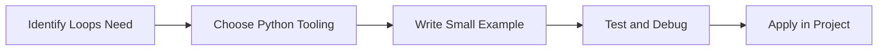

> **Level 1: Beginner** · Topic 11 of 35

[← Conditional Statements](./10-conditional-statements.md) · [↑ Level index](../README.md) · [Nested Loops →](./12-nested-loops.md)

# Loops

## Overview
- **What is it?** Loops repeat work over collections, ranges, streams, or conditions.
- **Why is it important?** Automate repetitive tasks without duplicating code.
- **Where is it used?** Software teams, education, automation, analytics, and backend development.

## Learning Objectives
- Gain the practical skill to explain, write, debug, and review loops code.
- Cover the vocabulary, syntax, workflow, edge cases, and professional habits behind loops.
- Expected outcome: you can use loops in a small project and recognize when it belongs in production code.

## Real World Applications
- **Industry use cases:** Software teams, education, automation, analytics, and backend development.
- **Business applications:** Reduce manual work, improve reliability, support reporting, automate decisions, and ship maintainable features.
- **Career relevance:** Supports Python developer, backend engineer, data engineer, AI engineer, DevOps engineer, QA automation, and cybersecurity automation roles.

## Core Concepts

### Mental Model
- **Definition:** The main idea that gives loops its structure and purpose inside a Python program.
- **Visual explanation:** `problem -> Loops model -> clear code`
- **Practical example:**

```python
apply_loops_label = "Loops"
print(apply_loops_label)
```

### Execution Flow
- **Definition:** The ordered steps Python follows when loops code is created, executed, or integrated.
- **Visual explanation:** `input -> Python operation -> result -> feedback`
- **Practical example:**

```python
for number in range(3):
    print(number)
```

### Quality Rule
- **Definition:** The reliability habit that keeps loops understandable, testable, secure, and maintainable.
- **Visual explanation:** `working code -> validation -> production confidence`
- **Practical example:**

```python
orders = [42, 75, 120]
total = 0
for order in orders:
    total += order
print(total)
```

## Infographic Summary

| Infographic Block | Key Message |
| --- | --- |
| 📌 Concept | Loops belongs to the core programming foundation part of Python mastery. |
| ⚡ Purpose | Automate repetitive tasks without duplicating code. |
| 🔥 Benefits | Batch processing, reporting, scraping, and simulations. |
| 🎯 Use Cases | Software teams, education, automation, analytics, and backend development. |
| 🚀 Best Practices | Prefer readable names, small examples, explicit errors, tests, documentation, and version-aware choices. |
| ❌ Common Mistakes | Copying code without understanding it, ignoring edge cases, skipping validation, and mixing unrelated responsibilities. |

## Syntax Guide

### Basic Syntax

```python
for item in items:
    print(item)

while queue:
    queue.pop(0)
```

### Standard Structure

```python
def apply_loops(value):
    """Apply the Loops concept to one value."""
    return value

result = apply_loops("practice")
print(result)
```

### Code Pattern

```python
# 1. Identify the Loops problem
# 2. Apply the correct Python structure
# 3. Validate the result with tests or output
```

## Examples

### Beginner Example

```python
for number in range(3):
    print(number)
```

### Intermediate Example

```python
orders = [42, 75, 120]
total = 0
for order in orders:
    total += order
print(total)
```

### Advanced Example

```python
from itertools import accumulate

values = [5, 10, 15]
print(list(accumulate(values)))
```

## Workflow Diagram




---

---

[← Conditional Statements](./10-conditional-statements.md) · [↑ Level index](../README.md) · [Nested Loops →](./12-nested-loops.md)
