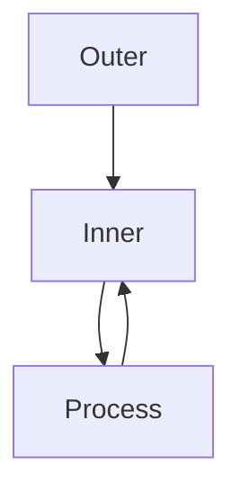

# Nested Loops

## Overview

- **What is it?** Nested loops place one loop inside another to handle multi-dimensional iteration.
- **Why is it important?** Matrices, grids, combinations, and nested records require nested iteration.
- **Where is it used?** Image pixels, seat maps, cartesian products, nested JSON.

## Learning Objectives

- **Skills gained:** Practical command of Nested Loops.
- **Concepts covered:**

- Write nested for loops for 2D data.
- Control complexity with helper functions.
- Break early when possible.

- **Expected outcome:** You traverse nested structures without losing readability.

## Real World Applications

- Graphics
- Scheduling
- E-commerce bundles
- Simulation

- **Business applications:** Automate workflows, reduce manual errors, accelerate delivery.
- **Career relevance:** Required knowledge for Python roles from junior developer to senior engineer.

## Core Concepts

### Outer loop

- **Definition:** Controls major dimension.
- **Visual explanation:** `Outer loop` → process → result
- **Practical example:**

```python
for row in [[1, 2], [3]]:
    print(row)
```

### Inner loop

- **Definition:** Processes each element in a row.
- **Visual explanation:** `Inner loop` → process → result
- **Practical example:**

```python
for row in [[1, 2], [3]]:
    for x in row:
        print(x)
```

### Cartesian product

- **Definition:** Nested loops generate pairs.
- **Visual explanation:** `Cartesian product` → process → result
- **Practical example:**

```python
pairs = [(a, b) for a in range(2) for b in range(2)]
print(len(pairs))
```

## Infographic Summary

| Block | Summary |
| --- | --- |
| 📌 Concept | Nested loops walk structures with more than one dimension. |
| ⚡ Purpose | Visit every combination or nested element systematically. |
| 🔥 Benefits | Straightforward for small data, easy to reason about. |
| 🎯 Use Cases | Multiplication tables, board games, nested categories. |
| 🚀 Best Practices | Extract inner body to functions; consider itertools.product. |
| ❌ Common Mistakes | O(n^3) surprises, deep nesting without bounds, reusing loop variable names. |

## Syntax Guide

### Basic Syntax

```python
for i in range(2):
    for j in range(2):
        print(i, j)
```

### Standard Structure

```python
outer init -> inner init -> body -> inner next -> outer next
```

### Code Pattern

```python
for y in rows:
    for x in y:
        print(x)
```

## Examples

### Beginner Example

```python
for r in range(2):
    for c in range(2):
        print(r, c)
```

### Intermediate Example

```python
matrix = [[1, 2], [3, 4]]
flat = [x for row in matrix for x in row]
print(flat)
```

### Advanced Example

```python
from itertools import product

for a, b in product(['A', 'B'], [1, 2]):
    print(a, b)
```

## Workflow Diagram



---
