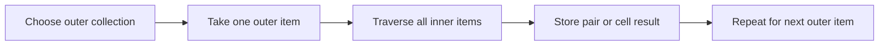

> **Level 1: Beginner** · Topic 12 of 35

[← Loops](./11-loops.md) · [↑ Level index](../README.md) · [Break Continue Pass →](./13-break-continue-pass.md)

# Nested Loops

## Overview
- **What is it?** A nested loop places one loop inside another so every outer item can be paired with or traversed across inner items.
- **Why is it important?** This structure represents grids, tables, combinations, and grouped records.
- **Where is it used?** Nested iteration appears in seating charts, matrices, schedules, and comparison tasks.

## Learning Objectives
- Trace outer and inner loop execution order.
- Generate coordinates or pairwise combinations.
- Estimate total iterations and avoid unnecessary quadratic work.

## Real World Applications
- Process each cell in a table.
- Create combinations of colors and sizes.
- Render rows and columns of a board.

## Core Concepts

### Outer and inner cycles
- **Definition:** The inner loop completes all its iterations for each single outer-loop item.
- **Visual explanation:** `outer item -> all inner items -> next outer item`
- **Practical example:**

```python
for row in range(2):
    for column in range(3):
        print(row, column)
```

### Two-dimensional data
- **Definition:** Rows can be iterables whose elements are visited by an inner loop.
- **Visual explanation:** `matrix -> row -> cell`
- **Practical example:**

```python
grid = [[1, 2], [3, 4]]
for row in grid:
    for cell in row:
        print(cell)
```

### Cost of nesting
- **Definition:** If outer and inner loops each visit `n` items, the body may execute `n²` times.
- **Visual explanation:** `n outer x n inner = n squared pairs`
- **Practical example:**

```python
items = ["A", "B", "C"]
pairs = 0
for left in items:
    for right in items:
        pairs += 1
print(pairs)
```

## Infographic Summary

| Infographic Block | Topic-Specific Takeaway |
| --- | --- |
| 📌 Concept | A nested loop places one loop inside another so every outer item can be paired with or traversed across inner items. |
| ⚡ Purpose | Traverse grids, grouped data, and combinations across two or more dimensions. |
| 🔥 Benefits | This structure represents grids, tables, combinations, and grouped records. |
| 🎯 Use Cases | Nested iteration appears in seating charts, matrices, schedules, and comparison tasks. |
| 🚀 Best Practices | Name loop variables by dimension and calculate the expected body executions before processing large inputs. |
| ❌ Common Mistakes | Using nested loops for a membership lookup that a set could perform directly. |

## Syntax Guide

### Basic Syntax

```python
for row in range(2):
    for column in range(2):
        print(f"({row}, {column})")
```

### Standard Structure

```python
colors = ["red", "blue"]
sizes = ["S", "M", "L"]
for color in colors:
    for size in sizes:
        print(color, size)
```

### Code Pattern

```python
matrix = [[3, 5, 7], [2, 4, 6]]
row_totals = []
for row in matrix:
    total = 0
    for value in row:
        total += value
    row_totals.append(total)
print(row_totals)
```

## Examples

### Beginner Example

```python
for row in range(3):
    for column in range(2):
        print(row, column)
```

### Intermediate Example

```python
teams = ["North", "South", "West"]
for index, home in enumerate(teams):
    for away in teams[index + 1:]:
        print(home, "vs", away)
```

### Advanced Example

```python
sales = [[12, 9], [8, 14], [10, 11]]
grand_total = 0
for day_index, day in enumerate(sales, start=1):
    day_total = 0
    for amount in day:
        day_total += amount
    grand_total += day_total
    print(f"Day {day_index}: {day_total}")
print("All days:", grand_total)
```

## Workflow Diagram



---

[← Loops](./11-loops.md) · [↑ Level index](../README.md) · [Break Continue Pass →](./13-break-continue-pass.md)
