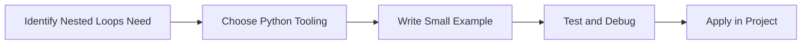

> **Level 1: Beginner** · Topic 12 of 35

[← Loops](./11-loops.md) · [↑ Level index](../README.md) · [Break Continue Pass →](./13-break-continue-pass.md)

# Nested Loops

## Overview
- **What is it?** Nested loops place one loop inside another to process grids, combinations, and hierarchical data.
- **Why is it important?** Traverse multi-dimensional or related datasets.
- **Where is it used?** Software teams, education, automation, analytics, and backend development.

## Learning Objectives
- Gain the practical skill to explain, write, debug, and review nested loops code.
- Cover the vocabulary, syntax, workflow, edge cases, and professional habits behind nested loops.
- Expected outcome: you can use nested loops in a small project and recognize when it belongs in production code.

## Real World Applications
- **Industry use cases:** Software teams, education, automation, analytics, and backend development.
- **Business applications:** Reduce manual work, improve reliability, support reporting, automate decisions, and ship maintainable features.
- **Career relevance:** Supports Python developer, backend engineer, data engineer, AI engineer, DevOps engineer, QA automation, and cybersecurity automation roles.

## Core Concepts

### Mental Model
- **Definition:** The main idea that gives nested loops its structure and purpose inside a Python program.
- **Visual explanation:** `problem -> Nested Loops model -> clear code`
- **Practical example:**

```python
apply_nested_loops_label = "Nested Loops"
print(apply_nested_loops_label)
```

### Execution Flow
- **Definition:** The ordered steps Python follows when nested loops code is created, executed, or integrated.
- **Visual explanation:** `input -> Python operation -> result -> feedback`
- **Practical example:**

```python
for row in range(2):
    for column in range(3):
        print(row, column)
```

### Quality Rule
- **Definition:** The reliability habit that keeps nested loops understandable, testable, secure, and maintainable.
- **Visual explanation:** `working code -> validation -> production confidence`
- **Practical example:**

```python
matrix = [[1, 2], [3, 4]]
flattened = []
for row in matrix:
    for value in row:
        flattened.append(value)
print(flattened)
```

## Infographic Summary

| Infographic Block | Key Message |
| --- | --- |
| 📌 Concept | Nested Loops belongs to the core programming foundation part of Python mastery. |
| ⚡ Purpose | Traverse multi-dimensional or related datasets. |
| 🔥 Benefits | Tables, matrices, schedules, inventory variants, and reports. |
| 🎯 Use Cases | Software teams, education, automation, analytics, and backend development. |
| 🚀 Best Practices | Prefer readable names, small examples, explicit errors, tests, documentation, and version-aware choices. |
| ❌ Common Mistakes | Copying code without understanding it, ignoring edge cases, skipping validation, and mixing unrelated responsibilities. |

## Syntax Guide

### Basic Syntax

```python
for row in grid:
    for cell in row:
        print(cell)
```

### Standard Structure

```python
def apply_nested_loops(value):
    """Apply the Nested Loops concept to one value."""
    return value

result = apply_nested_loops("practice")
print(result)
```

### Code Pattern

```python
# 1. Identify the Nested Loops problem
# 2. Apply the correct Python structure
# 3. Validate the result with tests or output
```

## Examples

### Beginner Example

```python
for row in range(2):
    for column in range(3):
        print(row, column)
```

### Intermediate Example

```python
matrix = [[1, 2], [3, 4]]
flattened = []
for row in matrix:
    for value in row:
        flattened.append(value)
print(flattened)
```

### Advanced Example

```python
pairs = [(x, y) for x in range(3) for y in range(3) if x != y]
print(pairs)
```

## Workflow Diagram




---

---

[← Loops](./11-loops.md) · [↑ Level index](../README.md) · [Break Continue Pass →](./13-break-continue-pass.md)
