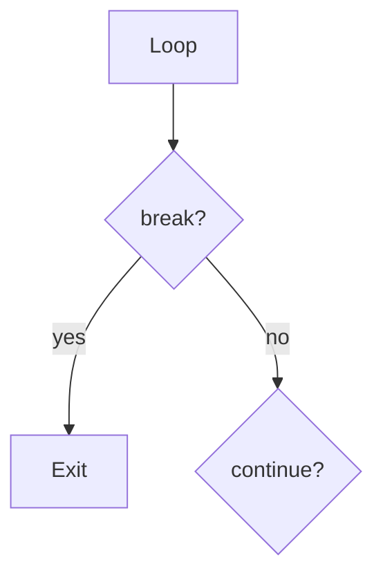

# Break Continue Pass

## Overview

- **What is it?** break, continue, and pass alter loop flow or serve as placeholders.
- **Why is it important?** They express early exit, skip iteration, or stub incomplete code cleanly.
- **Where is it used?** Search loops, validation pipelines, protocol stubs, parsers.

## Learning Objectives

- **Skills gained:** Practical command of Break Continue Pass.
- **Concepts covered:**

- Use break to exit loops early.
- Use continue to skip iterations.
- Use pass for empty blocks.

- **Expected outcome:** You control loop flow precisely without awkward flags.

## Real World Applications

- Log parsing
- Search features
- Games
- Network clients

- **Business applications:** Automate workflows, reduce manual errors, accelerate delivery.
- **Career relevance:** Required knowledge for Python roles from junior developer to senior engineer.

## Core Concepts

### break

- **Definition:** Exit the nearest enclosing loop.
- **Visual explanation:** `break` → process → result
- **Practical example:**

```python
for n in range(10):
    if n == 3:
        break
print('done')
```

### continue

- **Definition:** Skip to next iteration.
- **Visual explanation:** `continue` → process → result
- **Practical example:**

```python
for n in range(5):
    if n % 2 == 0:
        continue
    print(n)
```

### pass

- **Definition:** Null statement preserving syntax.
- **Visual explanation:** `pass` → process → result
- **Practical example:**

```python
def todo():
    pass
print(callable(todo))
```

## Infographic Summary

| Block | Summary |
| --- | --- |
| 📌 Concept | Flow keywords fine-tune iteration without extra state variables. |
| ⚡ Purpose | Express skip, stop, or stub directly in loops and classes. |
| 🔥 Benefits | Clearer loops, less boilerplate, valid empty blocks. |
| 🎯 Use Cases | Find first match, filter invalid rows, TDD stubs. |
| 🚀 Best Practices | Prefer functions over deeply broken loops; document pass usage. |
| ❌ Common Mistakes | break only breaks one level, continue in wrong place, pass hiding missing logic. |

## Syntax Guide

### Basic Syntax

```python
for x in xs:
    if x < 0:
        continue
    print(x)
```

### Standard Structure

```python
loop -> test -> break/continue/pass -> body
```

### Code Pattern

```python
for item in items:
    if item is None:
        continue
    print(item)
```

## Examples

### Beginner Example

```python
for i in range(5):
    if i == 3:
        break
    print(i)
```

### Intermediate Example

```python
evens = []
for n in range(6):
    if n % 2:
        continue
    evens.append(n)
print(evens)
```

### Advanced Example

```python
class Parser:
    def feed(self, chunk: bytes) -> None:
        pass


print(hasattr(Parser(), 'feed'))
```

## Workflow Diagram



---
