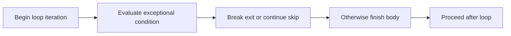

> **Level 1: Beginner** · Topic 13 of 35

[← Nested Loops](./12-nested-loops.md) · [↑ Level index](../README.md) · [Strings →](./14-strings.md)

# Break Continue Pass

## Overview
- **What is it?** `break` exits the nearest loop, `continue` skips to its next iteration, and `pass` is a statement that intentionally does nothing.
- **Why is it important?** These statements express early exit, selective skipping, and temporarily empty suites.
- **Where is it used?** Searches, input filters, parsers, and staged implementations use these controls.

## Learning Objectives
- Exit a search as soon as a match is found.
- Skip invalid items without skipping the entire loop.
- Use `pass` only where Python requires a suite and no behavior is intended yet.

## Real World Applications
- Stop reading after a sentinel value.
- Ignore malformed or irrelevant records.
- Sketch a function or class body before implementation.

## Core Concepts

### Break
- **Definition:** `break` immediately terminates only the innermost enclosing `for` or `while` loop.
- **Visual explanation:** `loop -> match -> break -> after loop`
- **Practical example:**

```python
for number in [3, 8, 11]:
    if number % 2 == 0:
        print(number)
        break
```

### Continue
- **Definition:** `continue` abandons the rest of the current iteration and requests the next item.
- **Visual explanation:** `item -> reject -> continue -> next item`
- **Practical example:**

```python
for value in [4, -1, 7]:
    if value < 0:
        continue
    print(value)
```

### Pass
- **Definition:** `pass` satisfies Python's requirement for a statement but has no runtime effect.
- **Visual explanation:** `required suite -> pass -> continue normally`
- **Practical example:**

```python
def planned_feature():
    pass

print(planned_feature())
```

## Infographic Summary

| Infographic Block | Topic-Specific Takeaway |
| --- | --- |
| 📌 Concept | `break` exits the nearest loop, `continue` skips to its next iteration, and `pass` is a statement that intentionally does nothing. |
| ⚡ Purpose | Exit, skip, or intentionally leave empty parts of a control-flow structure. |
| 🔥 Benefits | These statements express early exit, selective skipping, and temporarily empty suites. |
| 🎯 Use Cases | Searches, input filters, parsers, and staged implementations use these controls. |
| 🚀 Best Practices | Prefer clear loop conditions; use `break` and `continue` when they make exceptional paths easier to read. |
| ❌ Common Mistakes | Expecting `break` in an inner loop to exit every enclosing loop. |

## Syntax Guide

### Basic Syntax

```python
for number in range(10):
    if number == 3:
        break
    print(number)
```

### Standard Structure

```python
for text in ["12", "bad", "7"]:
    if not text.isdigit():
        continue
    print(int(text) * 2)
```

### Code Pattern

```python
def find_user(records, target_id):
    for record in records:
        if "id" not in record:
            continue
        if record["id"] == target_id:
            return record
    return None

users = [{}, {"id": 2, "name": "Ada"}]
print(find_user(users, 2))
```

## Examples

### Beginner Example

```python
for letter in "code":
    if letter == "d":
        break
    print(letter)
```

### Intermediate Example

```python
valid_scores = []
for score in [88, -5, 104, 73]:
    if not 0 <= score <= 100:
        continue
    valid_scores.append(score)
print(valid_scores)
```

### Advanced Example

```python
commands = ["status", "", "quit", "ignored"]
for command in commands:
    if not command:
        continue
    if command == "quit":
        print("Stopping")
        break
    print("Running", command)
else:
    print("All commands completed")
```

## Workflow Diagram



---

[← Nested Loops](./12-nested-loops.md) · [↑ Level index](../README.md) · [Strings →](./14-strings.md)
