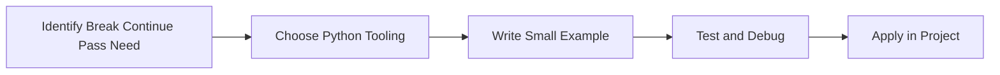

> **Level 1: Beginner** · Topic 13 of 35

[← Nested Loops](./12-nested-loops.md) · [↑ Level index](../README.md) · [Strings →](./14-strings.md)

# Break Continue Pass

## Overview
- **What is it?** break, continue, and pass control loop flow and placeholder behavior.
- **Why is it important?** Exit early, skip work, or reserve structure intentionally.
- **Where is it used?** Software teams, education, automation, analytics, and backend development.

## Learning Objectives
- Gain the practical skill to explain, write, debug, and review break continue pass code.
- Cover the vocabulary, syntax, workflow, edge cases, and professional habits behind break continue pass.
- Expected outcome: you can use break continue pass in a small project and recognize when it belongs in production code.

## Real World Applications
- **Industry use cases:** Software teams, education, automation, analytics, and backend development.
- **Business applications:** Reduce manual work, improve reliability, support reporting, automate decisions, and ship maintainable features.
- **Career relevance:** Supports Python developer, backend engineer, data engineer, AI engineer, DevOps engineer, QA automation, and cybersecurity automation roles.

## Core Concepts

### Mental Model
- **Definition:** The main idea that gives break continue pass its structure and purpose inside a Python program.
- **Visual explanation:** `problem -> Break Continue Pass model -> clear code`
- **Practical example:**

```python
apply_break_continue_pass_label = "Break Continue Pass"
print(apply_break_continue_pass_label)
```

### Execution Flow
- **Definition:** The ordered steps Python follows when break continue pass code is created, executed, or integrated.
- **Visual explanation:** `input -> Python operation -> result -> feedback`
- **Practical example:**

```python
for number in range(5):
    if number == 3:
        break
    print(number)
```

### Quality Rule
- **Definition:** The reliability habit that keeps break continue pass understandable, testable, secure, and maintainable.
- **Visual explanation:** `working code -> validation -> production confidence`
- **Practical example:**

```python
values = [10, None, 25, 0]
for value in values:
    if value is None:
        continue
    print(value)
```

## Infographic Summary

| Infographic Block | Key Message |
| --- | --- |
| 📌 Concept | Break Continue Pass belongs to the core programming foundation part of Python mastery. |
| ⚡ Purpose | Exit early, skip work, or reserve structure intentionally. |
| 🔥 Benefits | Cleaner loops, guard clauses, and progressive implementation. |
| 🎯 Use Cases | Software teams, education, automation, analytics, and backend development. |
| 🚀 Best Practices | Prefer readable names, small examples, explicit errors, tests, documentation, and version-aware choices. |
| ❌ Common Mistakes | Copying code without understanding it, ignoring edge cases, skipping validation, and mixing unrelated responsibilities. |

## Syntax Guide

### Basic Syntax

```python
for item in items:
    if item is None:
        continue
    if item == "stop":
        break
    pass
```

### Standard Structure

```python
def apply_break_continue_pass(value):
    """Apply the Break Continue Pass concept to one value."""
    return value

result = apply_break_continue_pass("practice")
print(result)
```

### Code Pattern

```python
# 1. Identify the Break Continue Pass problem
# 2. Apply the correct Python structure
# 3. Validate the result with tests or output
```

## Examples

### Beginner Example

```python
for number in range(5):
    if number == 3:
        break
    print(number)
```

### Intermediate Example

```python
values = [10, None, 25, 0]
for value in values:
    if value is None:
        continue
    print(value)
```

### Advanced Example

```python
class FutureValidator:
    def validate(self, value):
        pass

print(FutureValidator().validate("draft"))
```

## Workflow Diagram




---

---

[← Nested Loops](./12-nested-loops.md) · [↑ Level index](../README.md) · [Strings →](./14-strings.md)
