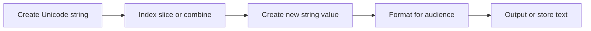

> **Level 1: Beginner** · Topic 14 of 35

[← Break Continue Pass](./13-break-continue-pass.md) · [↑ Level index](../README.md) · [String Methods →](./15-string-methods.md)

# Strings

## Overview
- **What is it?** A string is an immutable sequence of Unicode characters written with quotes.
- **Why is it important?** Strings model human-readable text and support indexing, slicing, concatenation, and interpolation.
- **Where is it used?** Names, messages, identifiers, file content, and serialized data are commonly represented as strings.

## Learning Objectives
- Create strings with appropriate quoting and escape sequences.
- Access characters and substrings by index or slice.
- Build readable output with f-strings while respecting immutability.

## Real World Applications
- Display personalized messages.
- Extract parts of codes or filenames.
- Compose labels, logs, and reports from data.

## Core Concepts

### Unicode text sequence
- **Definition:** Each string contains an ordered sequence of characters and has a measurable length.
- **Visual explanation:** `text -> character at index 0, 1, 2 ...`
- **Practical example:**

```python
word = "Python"
print(len(word), word[0], word[-1])
```

### Slicing
- **Definition:** A slice returns a new string from a start index up to, but not including, a stop index.
- **Visual explanation:** `text[start:stop:step] -> new text`
- **Practical example:**

```python
code = "PY-2026-BEGIN"
print(code[:2], code[3:7])
```

### Immutability and formatting
- **Definition:** Characters cannot be assigned in place; operations and f-strings create new strings.
- **Visual explanation:** `original string -> operation -> new string`
- **Practical example:**

```python
name = "Sam"
lessons = 5
message = f"{name} completed {lessons} lessons."
print(message)
```

## Infographic Summary

| Infographic Block | Topic-Specific Takeaway |
| --- | --- |
| 📌 Concept | A string is an immutable sequence of Unicode characters written with quotes. |
| ⚡ Purpose | Represent and compose immutable Unicode text. |
| 🔥 Benefits | Strings model human-readable text and support indexing, slicing, concatenation, and interpolation. |
| 🎯 Use Cases | Names, messages, identifiers, file content, and serialized data are commonly represented as strings. |
| 🚀 Best Practices | Use f-strings for interpolation, explicit encodings for files, and slices whose boundaries are easy to explain. |
| ❌ Common Mistakes | Trying to assign `text[0] = 'X'`; strings are immutable, so construct a new string instead. |

## Syntax Guide

### Basic Syntax

```python
single = "Python"
multiline = """First line
Second line"""
print(single, multiline)
```

### Standard Structure

```python
language = "Python"
print(language[0])
print(language[1:4])
print(language[::-1])
```

### Code Pattern

```python
customer = "Rina"
subtotal = 47.5
receipt = f"Customer: {customer}\nTotal: ${subtotal:,.2f}"
print(receipt)
```

## Examples

### Beginner Example

```python
greeting = "Hello"
print(greeting + " Python")
```

### Intermediate Example

```python
filename = "report.csv"
stem = filename[:-4]
extension = filename[-3:]
print(stem, extension)
```

### Advanced Example

```python
product = "Notebook"
quantity = 3
unit_price = 4.25
line = f"{product:<12} {quantity:>2} x ${unit_price:>5.2f} = ${quantity * unit_price:>6.2f}"
print(line)
```

## Workflow Diagram



---

[← Break Continue Pass](./13-break-continue-pass.md) · [↑ Level index](../README.md) · [String Methods →](./15-string-methods.md)
