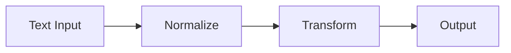

# Strings

## Overview

- **What is it?** Strings are immutable sequences of Unicode characters.
- **Why is it important?** Text processing is central to APIs, logs, and user interfaces.
- **Where is it used?** Web apps, document tools, NLP preprocessing, log parsers.

## Learning Objectives

- **Skills gained:** Practical command of Strings.
- **Concepts covered:**

- Create and slice strings.
- Use common string methods.
- Format output with f-strings.

- **Expected outcome:** You manipulate and format text confidently in Python.

## Real World Applications

- Web frontends
- Log analysis
- Chatbots
- Document automation

- **Business applications:** Automate workflows, reduce manual errors, accelerate delivery.
- **Career relevance:** Required knowledge for Python roles from junior developer to senior engineer.

## Core Concepts

### Literals

- **Definition:** Quoted text creates str objects.
- **Visual explanation:** `Literals` → process → result
- **Practical example:**

```python
msg = 'hello'
print(msg.upper())
```

### Slicing

- **Definition:** Extract subsequences by index.
- **Visual explanation:** `Slicing` → process → result
- **Practical example:**

```python
print('Python'[0:2])
```

### f-strings

- **Definition:** Embed expressions in strings.
- **Visual explanation:** `f-strings` → process → result
- **Practical example:**

```python
name = 'Ada'
print(f'Hi {name}')
```

## Infographic Summary

| Block | Summary |
| --- | --- |
| 📌 Concept | Strings are immutable Unicode text. |
| ⚡ Purpose | Represent and transform textual data. |
| 🔥 Benefits | Rich methods, easy formatting, UTF-8 by default. |
| 🎯 Use Cases | User names, templates, CSV fields, HTTP bodies. |
| 🚀 Best Practices | Prefer f-strings; avoid concatenating in tight loops. |
| ❌ Common Mistakes | Mutating strings, poor encoding handling, O(n^2) concat. |

## Syntax Guide

### Basic Syntax

```python
greeting = 'Hello'
print(greeting + ' World')
```

### Standard Structure

```python
create -> transform -> format -> output
```

### Code Pattern

```python
label = f'item: {name}'
print(label)
```

## Examples

### Beginner Example

```python
text = '  Python  '
print(text.strip().lower())
```

### Intermediate Example

```python
words = 'a,b,c'.split(',')
print('-'.join(words))
```

### Advanced Example

```python
import re

print(re.sub(r'\d+', '#', 'Room 42'))
```

## Workflow Diagram



---
