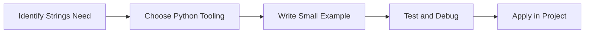

> **Level 1: Beginner** · Topic 14 of 35

[← Break Continue Pass](./13-break-continue-pass.md) · [↑ Level index](../README.md) · [String Methods →](./15-string-methods.md)

# Strings

## Overview
- **What is it?** Strings are immutable text sequences.
- **Why is it important?** Store, inspect, format, and transform text.
- **Where is it used?** Software teams, education, automation, analytics, and backend development.

## Learning Objectives
- Gain the practical skill to explain, write, debug, and review strings code.
- Cover the vocabulary, syntax, workflow, edge cases, and professional habits behind strings.
- Expected outcome: you can use strings in a small project and recognize when it belongs in production code.

## Real World Applications
- **Industry use cases:** Software teams, education, automation, analytics, and backend development.
- **Business applications:** Reduce manual work, improve reliability, support reporting, automate decisions, and ship maintainable features.
- **Career relevance:** Supports Python developer, backend engineer, data engineer, AI engineer, DevOps engineer, QA automation, and cybersecurity automation roles.

## Core Concepts

### Mental Model
- **Definition:** The main idea that gives strings its structure and purpose inside a Python program.
- **Visual explanation:** `problem -> Strings model -> clear code`
- **Practical example:**

```python
apply_strings_label = "Strings"
print(apply_strings_label)
```

### Execution Flow
- **Definition:** The ordered steps Python follows when strings code is created, executed, or integrated.
- **Visual explanation:** `input -> Python operation -> result -> feedback`
- **Practical example:**

```python
greeting = "Hello"
print(greeting + " Python")
```

### Quality Rule
- **Definition:** The reliability habit that keeps strings understandable, testable, secure, and maintainable.
- **Visual explanation:** `working code -> validation -> production confidence`
- **Practical example:**

```python
template = "{product}: ${price:.2f}"
print(template.format(product="Book", price=29.99))
```

## Infographic Summary

| Infographic Block | Key Message |
| --- | --- |
| 📌 Concept | Strings belongs to the core programming foundation part of Python mastery. |
| ⚡ Purpose | Store, inspect, format, and transform text. |
| 🔥 Benefits | User messages, logs, APIs, documents, and identifiers. |
| 🎯 Use Cases | Software teams, education, automation, analytics, and backend development. |
| 🚀 Best Practices | Prefer readable names, small examples, explicit errors, tests, documentation, and version-aware choices. |
| ❌ Common Mistakes | Copying code without understanding it, ignoring edge cases, skipping validation, and mixing unrelated responsibilities. |

## Syntax Guide

### Basic Syntax

```python
name = "Python"
print(name[0])
print(name.lower())
```

### Standard Structure

```python
def apply_strings(value):
    """Apply the Strings concept to one value."""
    return value

result = apply_strings("practice")
print(result)
```

### Code Pattern

```python
# 1. Identify the Strings problem
# 2. Apply the correct Python structure
# 3. Validate the result with tests or output
```

## Examples

### Beginner Example

```python
greeting = "Hello"
print(greeting + " Python")
```

### Intermediate Example

```python
template = "{product}: ${price:.2f}"
print(template.format(product="Book", price=29.99))
```

### Advanced Example

```python
from string import Template

template = Template("Hello, $name")
print(template.safe_substitute(name="Grace"))
```

## Workflow Diagram




---

---

[← Break Continue Pass](./13-break-continue-pass.md) · [↑ Level index](../README.md) · [String Methods →](./15-string-methods.md)
