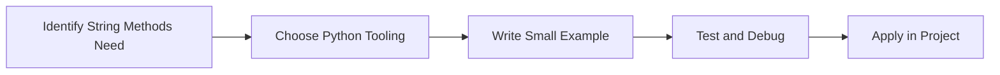

> **Level 1: Beginner** · Topic 15 of 35

[← Strings](./14-strings.md) · [↑ Level index](../README.md) · [Lists →](./16-lists.md)

# String Methods

## Overview
- **What is it?** String methods are built-in operations for searching, cleaning, splitting, joining, and formatting text.
- **Why is it important?** Make text processing reliable and expressive.
- **Where is it used?** Software teams, education, automation, analytics, and backend development.

## Learning Objectives
- Gain the practical skill to explain, write, debug, and review string methods code.
- Cover the vocabulary, syntax, workflow, edge cases, and professional habits behind string methods.
- Expected outcome: you can use string methods in a small project and recognize when it belongs in production code.

## Real World Applications
- **Industry use cases:** Software teams, education, automation, analytics, and backend development.
- **Business applications:** Reduce manual work, improve reliability, support reporting, automate decisions, and ship maintainable features.
- **Career relevance:** Supports Python developer, backend engineer, data engineer, AI engineer, DevOps engineer, QA automation, and cybersecurity automation roles.

## Core Concepts

### Mental Model
- **Definition:** The main idea that gives string methods its structure and purpose inside a Python program.
- **Visual explanation:** `problem -> String Methods model -> clear code`
- **Practical example:**

```python
apply_string_methods_label = "String Methods"
print(apply_string_methods_label)
```

### Execution Flow
- **Definition:** The ordered steps Python follows when string methods code is created, executed, or integrated.
- **Visual explanation:** `input -> Python operation -> result -> feedback`
- **Practical example:**

```python
greeting = "Hello"
print(greeting + " Python")
```

### Quality Rule
- **Definition:** The reliability habit that keeps string methods understandable, testable, secure, and maintainable.
- **Visual explanation:** `working code -> validation -> production confidence`
- **Practical example:**

```python
template = "{product}: ${price:.2f}"
print(template.format(product="Book", price=29.99))
```

## Infographic Summary

| Infographic Block | Key Message |
| --- | --- |
| 📌 Concept | String Methods belongs to the core programming foundation part of Python mastery. |
| ⚡ Purpose | Make text processing reliable and expressive. |
| 🔥 Benefits | Data cleaning, validation, parsing, search, and reporting. |
| 🎯 Use Cases | Software teams, education, automation, analytics, and backend development. |
| 🚀 Best Practices | Prefer readable names, small examples, explicit errors, tests, documentation, and version-aware choices. |
| ❌ Common Mistakes | Copying code without understanding it, ignoring edge cases, skipping validation, and mixing unrelated responsibilities. |

## Syntax Guide

### Basic Syntax

```python
name = "Python"
print(name[0])
print(name.lower())
```

### Standard Structure

```python
def apply_string_methods(value):
    """Apply the String Methods concept to one value."""
    return value

result = apply_string_methods("practice")
print(result)
```

### Code Pattern

```python
# 1. Identify the String Methods problem
# 2. Apply the correct Python structure
# 3. Validate the result with tests or output
```

## Examples

### Beginner Example

```python
greeting = "Hello"
print(greeting + " Python")
```

### Intermediate Example

```python
template = "{product}: ${price:.2f}"
print(template.format(product="Book", price=29.99))
```

### Advanced Example

```python
from string import Template

template = Template("Hello, $name")
print(template.safe_substitute(name="Grace"))
```

## Workflow Diagram




---

---

[← Strings](./14-strings.md) · [↑ Level index](../README.md) · [Lists →](./16-lists.md)
