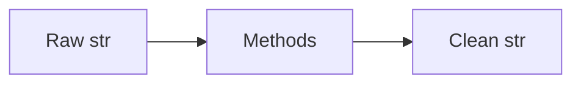

# String Methods

## Overview

- **What is it?** String methods provide built-in operations for searching, splitting, and formatting text.
- **Why is it important?** Method calls replace hand-written parsing for common text tasks.
- **Where is it used?** Data cleaning, URL handling, validation, templating.

## Learning Objectives

- **Skills gained:** Practical command of String Methods.
- **Concepts covered:**

- Apply strip, split, join, replace, and find.
- Choose methods vs regex appropriately.
- Chain operations readably.

- **Expected outcome:** You clean and transform strings using the str API efficiently.

## Real World Applications

- Marketing analytics
- Support tickets
- SEO tools
- Compliance redaction

- **Business applications:** Automate workflows, reduce manual errors, accelerate delivery.
- **Career relevance:** Required knowledge for Python roles from junior developer to senior engineer.

## Core Concepts

### strip

- **Definition:** Remove leading/trailing whitespace.
- **Visual explanation:** `strip` → process → result
- **Practical example:**

```python
print('  hi  '.strip())
```

### split/join

- **Definition:** Tokenize and reassemble strings.
- **Visual explanation:** `split/join` → process → result
- **Practical example:**

```python
print('-'.join('a b c'.split()))
```

### replace

- **Definition:** Substitute substrings.
- **Visual explanation:** `replace` → process → result
- **Practical example:**

```python
print('foo-bar'.replace('-', '_'))
```

## Infographic Summary

| Block | Summary |
| --- | --- |
| 📌 Concept | str methods operate on immutable copies. |
| ⚡ Purpose | Standardize text transformations. |
| 🔥 Benefits | Readable, fast C implementations, fewer bugs. |
| 🎯 Use Cases | Normalizing emails, parsing tags, masking PII. |
| 🚀 Best Practices | Normalize once; store canonical form; handle None before calling. |
| ❌ Common Mistakes | Calling methods on None, locale-unaware case folding, excessive regex. |

## Syntax Guide

### Basic Syntax

```python
email = ' Ada@Example.COM '
print(email.strip().lower())
```

### Standard Structure

```python
normalize -> tokenize -> transform -> join
```

### Code Pattern

```python
parts = line.strip().split(',')
print(parts)
```

## Examples

### Beginner Example

```python
print('hello world'.title())
```

### Intermediate Example

```python
slug = 'Hello World'.lower().replace(' ', '-')
print(slug)
```

### Advanced Example

```python
from textwrap import dedent as d

block = d('''                line one
    line two
''')
print(block.splitlines())
```

## Workflow Diagram



---
