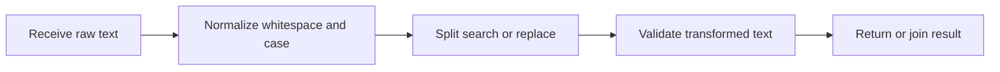

> **Level 1: Beginner** · Topic 15 of 35

[← Strings](./14-strings.md) · [↑ Level index](../README.md) · [Lists →](./16-lists.md)

# String Methods

## Overview
- **What is it?** String methods are built-in operations that inspect or return transformed versions of immutable strings.
- **Why is it important?** They provide dependable tools for normalization, searching, splitting, replacing, and joining text.
- **Where is it used?** Text cleaning, parsing, validation, and presentation rely on method chains.

## Learning Objectives
- Normalize whitespace and case with methods.
- Split text into pieces and join pieces into a string.
- Choose predicate and search methods without confusing returned values.

## Real World Applications
- Clean names and email addresses from forms.
- Parse comma-separated labels.
- Search and replace controlled pieces of text.

## Core Concepts

### Non-mutating transformations
- **Definition:** Methods such as `strip`, `lower`, and `replace` return new strings because the original cannot change.
- **Visual explanation:** `original text -> method -> transformed copy`
- **Practical example:**

```python
raw = "  Python Basics  "
clean = raw.strip().lower()
print(clean, raw)
```

### Split and join
- **Definition:** `split` produces a list of substrings; `separator.join(iterable)` combines strings with that separator.
- **Visual explanation:** `string -> split -> list -> join -> string`
- **Practical example:**

```python
line = "red,green,blue"
colors = line.split(",")
print(" | ".join(colors))
```

### Search and predicates
- **Definition:** Methods such as `find`, `startswith`, and `isdigit` report positions or boolean facts about text.
- **Visual explanation:** `text -> inspection method -> index or bool`
- **Practical example:**

```python
filename = "lesson_15.md"
print(filename.startswith("lesson_"), filename.endswith(".md"))
print("15".isdigit())
```

## Infographic Summary

| Infographic Block | Topic-Specific Takeaway |
| --- | --- |
| 📌 Concept | String methods are built-in operations that inspect or return transformed versions of immutable strings. |
| ⚡ Purpose | Inspect, normalize, search, split, and combine text with built-in operations. |
| 🔥 Benefits | They provide dependable tools for normalization, searching, splitting, replacing, and joining text. |
| 🎯 Use Cases | Text cleaning, parsing, validation, and presentation rely on method chains. |
| 🚀 Best Practices | Store the returned string, and prefer explicit method sequences over dense chains when intermediate states matter. |
| ❌ Common Mistakes | Calling a method such as `strip()` without using its return value and expecting the original string to change. |

## Syntax Guide

### Basic Syntax

```python
name = "  ADA lovelace  "
print(name.strip().title())
```

### Standard Structure

```python
tags = "python, beginner, methods"
clean_tags = [tag.strip() for tag in tags.split(",")]
print("-".join(clean_tags))
```

### Code Pattern

```python
def normalize_username(text):
    cleaned = text.strip().lower().replace(" ", "_")
    if not cleaned.replace("_", "").isalnum():
        raise ValueError("Use letters, numbers, or spaces")
    return cleaned

print(normalize_username("  Ada Learns  "))
```

## Examples

### Beginner Example

```python
message = "hello python"
print(message.upper())
```

### Intermediate Example

```python
record = "  alice@example.com | active  "
email, status = [part.strip() for part in record.split("|")]
print(email.lower(), status)
```

### Advanced Example

```python
def title_from_slug(slug):
    words = slug.removesuffix(".md").split("-")
    return " ".join(words).title()

files = ["python-syntax.md", "list-methods.md"]
for filename in files:
    print(title_from_slug(filename))
```

## Workflow Diagram



---

[← Strings](./14-strings.md) · [↑ Level index](../README.md) · [Lists →](./16-lists.md)
