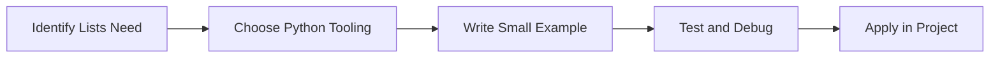

> **Level 1: Beginner** · Topic 16 of 35

[← String Methods](./15-string-methods.md) · [↑ Level index](../README.md) · [List Methods →](./17-list-methods.md)

# Lists

## Overview
- **What is it?** Lists are ordered, mutable collections.
- **Why is it important?** Store and update sequences of related items.
- **Where is it used?** Software teams, education, automation, analytics, and backend development.

## Learning Objectives
- Gain the practical skill to explain, write, debug, and review lists code.
- Cover the vocabulary, syntax, workflow, edge cases, and professional habits behind lists.
- Expected outcome: you can use lists in a small project and recognize when it belongs in production code.

## Real World Applications
- **Industry use cases:** Software teams, education, automation, analytics, and backend development.
- **Business applications:** Reduce manual work, improve reliability, support reporting, automate decisions, and ship maintainable features.
- **Career relevance:** Supports Python developer, backend engineer, data engineer, AI engineer, DevOps engineer, QA automation, and cybersecurity automation roles.

## Core Concepts

### Mental Model
- **Definition:** The main idea that gives lists its structure and purpose inside a Python program.
- **Visual explanation:** `problem -> Lists model -> clear code`
- **Practical example:**

```python
apply_lists_label = "Lists"
print(apply_lists_label)
```

### Execution Flow
- **Definition:** The ordered steps Python follows when lists code is created, executed, or integrated.
- **Visual explanation:** `input -> Python operation -> result -> feedback`
- **Practical example:**

```python
tasks = ["read", "practice", "review"]
print(tasks)
```

### Quality Rule
- **Definition:** The reliability habit that keeps lists understandable, testable, secure, and maintainable.
- **Visual explanation:** `working code -> validation -> production confidence`
- **Practical example:**

```python
scores = [88, 92, 79]
passed = [score for score in scores if score >= 80]
print(passed)
```

## Infographic Summary

| Infographic Block | Key Message |
| --- | --- |
| 📌 Concept | Lists belongs to the core programming foundation part of Python mastery. |
| ⚡ Purpose | Store and update sequences of related items. |
| 🔥 Benefits | Queues, records, batches, UI options, and data processing. |
| 🎯 Use Cases | Software teams, education, automation, analytics, and backend development. |
| 🚀 Best Practices | Prefer readable names, small examples, explicit errors, tests, documentation, and version-aware choices. |
| ❌ Common Mistakes | Copying code without understanding it, ignoring edge cases, skipping validation, and mixing unrelated responsibilities. |

## Syntax Guide

### Basic Syntax

```python
items = ["alpha", "beta"]
items.append("gamma")
print(items[0])
```

### Standard Structure

```python
def apply_lists(value):
    """Apply the Lists concept to one value."""
    return value

result = apply_lists("practice")
print(result)
```

### Code Pattern

```python
# 1. Identify the Lists problem
# 2. Apply the correct Python structure
# 3. Validate the result with tests or output
```

## Examples

### Beginner Example

```python
tasks = ["read", "practice", "review"]
print(tasks)
```

### Intermediate Example

```python
scores = [88, 92, 79]
passed = [score for score in scores if score >= 80]
print(passed)
```

### Advanced Example

```python
from bisect import insort

rankings = [10, 20, 40]
insort(rankings, 30)
print(rankings)
```

## Workflow Diagram




---

---

[← String Methods](./15-string-methods.md) · [↑ Level index](../README.md) · [List Methods →](./17-list-methods.md)
