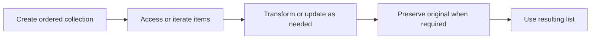

> **Level 1: Beginner** · Topic 16 of 35

[← String Methods](./15-string-methods.md) · [↑ Level index](../README.md) · [List Methods →](./17-list-methods.md)

# Lists

## Overview
- **What is it?** A list is an ordered, mutable collection whose elements can have any Python type.
- **Why is it important?** Lists model sequences that need indexing, iteration, growth, replacement, or removal.
- **Where is it used?** Shopping carts, task queues, readings, and search results are often stored in lists.

## Learning Objectives
- Create, index, slice, and update lists.
- Explain mutable list state and shallow copying.
- Use list comprehensions for clear one-to-one transformations.

## Real World Applications
- Track an ordered set of tasks.
- Collect measurements for later aggregation.
- Build a transformed result from source records.

## Core Concepts

### Order and indexing
- **Definition:** A list preserves insertion order and exposes zero-based positive and negative indexes.
- **Visual explanation:** `list -> index 0, 1, 2 ...`
- **Practical example:**

```python
cities = ["Accra", "Lima", "Oslo"]
print(cities[0], cities[-1])
```

### Mutable elements
- **Definition:** Index assignment changes a list element in place while preserving the list object's identity.
- **Visual explanation:** `list before -> assign index -> same list after`
- **Practical example:**

```python
statuses = ["new", "new"]
statuses[1] = "done"
print(statuses)
```

### Slices and comprehensions
- **Definition:** A slice copies a range; a comprehension constructs a new list by transforming or filtering an iterable.
- **Visual explanation:** `source -> expression for item if condition -> new list`
- **Practical example:**

```python
numbers = [1, 2, 3, 4]
squares = [number ** 2 for number in numbers if number % 2 == 0]
print(squares)
```

## Infographic Summary

| Infographic Block | Topic-Specific Takeaway |
| --- | --- |
| 📌 Concept | A list is an ordered, mutable collection whose elements can have any Python type. |
| ⚡ Purpose | Store and update an ordered sequence of related values. |
| 🔥 Benefits | Lists model sequences that need indexing, iteration, growth, replacement, or removal. |
| 🎯 Use Cases | Shopping carts, task queues, readings, and search results are often stored in lists. |
| 🚀 Best Practices | Keep list elements conceptually consistent and copy before mutation when another part of the program needs the original. |
| ❌ Common Mistakes | Modifying a list while iterating over it, which can skip or unexpectedly revisit elements. |

## Syntax Guide

### Basic Syntax

```python
tasks = ["read", "practice", "review"]
print(tasks[0], len(tasks))
```

### Standard Structure

```python
scores = [72, 81, 90]
scores[0] = 75
first_two = scores[:2]
print(scores, first_two)
```

### Code Pattern

```python
temperatures = [18.5, 21.0, 16.8, 23.2]
warm = [value for value in temperatures if value >= 20]
average = sum(temperatures) / len(temperatures)
print(warm, average)
```

## Examples

### Beginner Example

```python
fruits = ["apple", "pear", "mango"]
print(fruits[1])
```

### Intermediate Example

```python
prices = [3.5, 8.0, 2.25]
with_tax = [round(price * 1.1, 2) for price in prices]
print(with_tax)
```

### Advanced Example

```python
orders = [
    {"id": 1, "total": 25},
    {"id": 2, "total": 80},
    {"id": 3, "total": 55},
]
large_order_ids = [order["id"] for order in orders if order["total"] >= 50]
print(large_order_ids)
```

## Workflow Diagram



---

[← String Methods](./15-string-methods.md) · [↑ Level index](../README.md) · [List Methods →](./17-list-methods.md)
