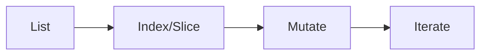

# Lists

## Overview

- **What is it?** Lists are ordered, mutable sequences of arbitrary objects.
- **Why is it important?** They are the default workhorse collection for ordered data.
- **Where is it used?** Queues, result sets, UI lists, algorithm inputs.

## Learning Objectives

- **Skills gained:** Practical command of Lists.
- **Concepts covered:**

- Create, index, slice, and mutate lists.
- Use list comprehensions.
- Copy lists safely.

- **Expected outcome:** You store and transform ordered collections fluently.

## Real World Applications

- Inventory systems
- Analytics
- Media playlists
- Task queues

- **Business applications:** Automate workflows, reduce manual errors, accelerate delivery.
- **Career relevance:** Required knowledge for Python roles from junior developer to senior engineer.

## Core Concepts

### Literals

- **Definition:** Square brackets build lists.
- **Visual explanation:** `Literals` → process → result
- **Practical example:**

```python
nums = [1, 2, 3]
print(nums[0])
```

### append

- **Definition:** Add element at end.
- **Visual explanation:** `append` → process → result
- **Practical example:**

```python
items = []
items.append('a')
print(items)
```

### Comprehension

- **Definition:** Build lists from iterables.
- **Visual explanation:** `Comprehension` → process → result
- **Practical example:**

```python
squares = [n * n for n in range(4)]
print(squares)
```

## Infographic Summary

| Block | Summary |
| --- | --- |
| 📌 Concept | Lists are dynamic arrays of references. |
| ⚡ Purpose | Hold ordered, changeable sequences. |
| 🔥 Benefits | Versatile, fast append/pop at end, rich API. |
| 🎯 Use Cases | Shopping carts, timelines, batch results. |
| 🚀 Best Practices | Avoid using as default args; copy before mutate shared data. |
| ❌ Common Mistakes | Shallow copy surprises, O(n) inserts at front, aliasing bugs. |

## Syntax Guide

### Basic Syntax

```python
fruits = ['apple', 'banana']
print(len(fruits))
```

### Standard Structure

```python
create -> access -> mutate -> iterate
```

### Code Pattern

```python
results = [transform(x) for x in data]
```

## Examples

### Beginner Example

```python
colors = ['red', 'green']
colors.append('blue')
print(colors)
```

### Intermediate Example

```python
matrix = [[1, 2], [3, 4]]
print([row[0] for row in matrix])
```

### Advanced Example

```python
from copy import deepcopy

original = [[1], [2]]
cloned = deepcopy(original)
cloned[0].append(9)
print(original, cloned)
```

## Workflow Diagram



---
