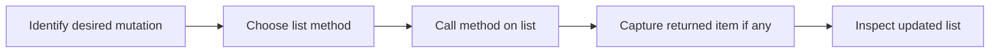

> **Level 1: Beginner** · Topic 17 of 35

[← Lists](./16-lists.md) · [↑ Level index](../README.md) · [Tuples →](./18-tuples.md)

# List Methods

## Overview
- **What is it?** List methods are operations attached to lists for adding, removing, locating, ordering, and copying elements.
- **Why is it important?** They expose list mutation directly and make collection maintenance concise.
- **Where is it used?** Task managers, carts, rankings, and processing queues use these methods to update state.

## Learning Objectives
- Use append, extend, insert, remove, and pop intentionally.
- Sort in place and distinguish `list.sort` from `sorted`.
- Copy a list and inspect method return values correctly.

## Real World Applications
- Add or remove cart items.
- Reorder scores or names.
- Consume queued work while retaining the removed item.

## Core Concepts

### Adding items
- **Definition:** `append` adds one object, `extend` adds each item from an iterable, and `insert` adds at an index.
- **Visual explanation:** `list -> append one or extend many -> mutated list`
- **Practical example:**

```python
topics = ["syntax"]
topics.append("lists")
topics.extend(["tuples", "sets"])
print(topics)
```

### Removing items
- **Definition:** `remove` deletes the first equal value, while `pop` deletes and returns an item by index.
- **Visual explanation:** `list -> remove by value or pop by position`
- **Practical example:**

```python
queue = ["first", "second"]
served = queue.pop(0)
print(served, queue)
```

### Ordering and copying
- **Definition:** `sort` mutates and returns `None`; `sorted` returns a new list, and `copy` makes a shallow list copy.
- **Visual explanation:** `source -> sorted copy; source.sort -> source reordered`
- **Practical example:**

```python
scores = [82, 95, 74]
ranked = sorted(scores, reverse=True)
print(scores, ranked)
```

## Infographic Summary

| Infographic Block | Topic-Specific Takeaway |
| --- | --- |
| 📌 Concept | List methods are operations attached to lists for adding, removing, locating, ordering, and copying elements. |
| ⚡ Purpose | Add, remove, locate, copy, and reorder elements in mutable lists. |
| 🔥 Benefits | They expose list mutation directly and make collection maintenance concise. |
| 🎯 Use Cases | Task managers, carts, rankings, and processing queues use these methods to update state. |
| 🚀 Best Practices | Check whether mutation is intended, and never assign the result of a method such as `append` or `sort`. |
| ❌ Common Mistakes | Writing `items = items.append(value)`, which replaces the list name with `None`. |

## Syntax Guide

### Basic Syntax

```python
tasks = ["read"]
tasks.append("practice")
print(tasks)
```

### Standard Structure

```python
names = ["Zoe", "ana", "Mika"]
names.sort(key=str.lower)
print(names)
```

### Code Pattern

```python
history = ["login", "view", "logout"]
working = history.copy()
last_event = working.pop()
working.insert(0, "session-start")
print(last_event, working, history)
```

## Examples

### Beginner Example

```python
colors = ["red"]
colors.extend(["green", "blue"])
print(colors)
```

### Intermediate Example

```python
inventory = ["pen", "book", "pen"]
inventory.remove("pen")
removed = inventory.pop()
print(inventory, removed)
```

### Advanced Example

```python
records = [
    {"name": "Ari", "score": 78},
    {"name": "Bea", "score": 91},
]
records.append({"name": "Chen", "score": 84})
records.sort(key=lambda record: record["score"], reverse=True)
print(records)
```

## Workflow Diagram



---

[← Lists](./16-lists.md) · [↑ Level index](../README.md) · [Tuples →](./18-tuples.md)
