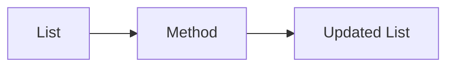

# List Methods

## Overview

- **What is it?** List methods mutate or query lists in place: sort, extend, pop, remove, and more.
- **Why is it important?** In-place operations save memory and express intent clearly.
- **Where is it used?** Sorting results, stack behavior, deduplication workflows.

## Learning Objectives

- **Skills gained:** Practical command of List Methods.
- **Concepts covered:**

- Use sort, reverse, extend, insert, pop, remove.
- Know which methods return None.
- Pick list vs set for uniqueness.

- **Expected outcome:** You update lists efficiently using the list API.

## Real World Applications

- Ranking dashboards
- Undo stacks
- Batch ETL
- Leaderboards

- **Business applications:** Automate workflows, reduce manual errors, accelerate delivery.
- **Career relevance:** Required knowledge for Python roles from junior developer to senior engineer.

## Core Concepts

### sort

- **Definition:** Order list in place.
- **Visual explanation:** `sort` → process → result
- **Practical example:**

```python
nums = [3, 1, 2]
nums.sort()
print(nums)
```

### pop

- **Definition:** Remove and return item.
- **Visual explanation:** `pop` → process → result
- **Practical example:**

```python
stack = [1, 2]
print(stack.pop())
```

### extend

- **Definition:** Add multiple items.
- **Visual explanation:** `extend` → process → result
- **Practical example:**

```python
a = [1]
a.extend([2, 3])
print(a)
```

## Infographic Summary

| Block | Summary |
| --- | --- |
| 📌 Concept | Mutating methods update the same list object. |
| ⚡ Purpose | Modify ordered collections without reassigning names. |
| 🔥 Benefits | Performance, clarity, idiomatic Python. |
| 🎯 Use Cases | Priority queues, rolling windows, in-memory buffers. |
| 🚀 Best Practices | sorted() for new list; key= for custom ordering. |
| ❌ Common Mistakes | Assigning sort result, modifying while iterating, pop empty list. |

## Syntax Guide

### Basic Syntax

```python
values = [3, 1, 2]
values.sort()
print(values)
```

### Standard Structure

```python
prepare list -> call method -> verify state
```

### Code Pattern

```python
items.extend(new_batch)
items.sort(key=len)
```

## Examples

### Beginner Example

```python
pets = ['cat', 'dog']
pets.append('bird')
print(pets)
```

### Intermediate Example

```python
data = ['b', 'a', 'c']
print(sorted(data))
print(data)
```

### Advanced Example

```python
from bisect import insort

scores = [10, 20, 40]
insort(scores, 25)
print(scores)
```

## Workflow Diagram



---
