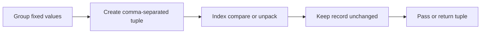

> **Level 1: Beginner** · Topic 18 of 35

[← List Methods](./17-list-methods.md) · [↑ Level index](../README.md) · [Sets →](./19-sets.md)

# Tuples

## Overview
- **What is it?** A tuple is an ordered, immutable collection commonly used for fixed groups of values.
- **Why is it important?** Its immutability communicates that the collection's positions and membership should not change.
- **Where is it used?** Coordinates, database rows, configuration pairs, and multi-value returns often use tuples.

## Learning Objectives
- Create single- and multi-item tuples.
- Index, unpack, and compare tuple values.
- Choose a tuple over a list when a fixed record is intended.

## Real World Applications
- Represent latitude and longitude.
- Return a minimum and maximum together.
- Use immutable composite keys in dictionaries.

## Core Concepts

### Tuple construction
- **Definition:** Commas create tuples; parentheses improve grouping, and a one-item tuple requires a trailing comma.
- **Visual explanation:** `value, value -> tuple`
- **Practical example:**

```python
point = (4, 7)
single = ("only",)
print(point, single)
```

### Unpacking
- **Definition:** Iterable unpacking binds tuple elements to matching names in one assignment.
- **Visual explanation:** `(x, y) -> x and y names`
- **Practical example:**

```python
location = ("Nairobi", "Kenya")
city, country = location
print(city, country)
```

### Immutable records
- **Definition:** Tuple elements cannot be replaced, though a mutable object stored inside a tuple can still change.
- **Visual explanation:** `fixed tuple positions -> safe record shape`
- **Practical example:**

```python
rgb = (120, 80, 200)
red, green, blue = rgb
print(max(rgb), red + green + blue)
```

## Infographic Summary

| Infographic Block | Topic-Specific Takeaway |
| --- | --- |
| 📌 Concept | A tuple is an ordered, immutable collection commonly used for fixed groups of values. |
| ⚡ Purpose | Group a fixed ordered set of values into one immutable record. |
| 🔥 Benefits | Its immutability communicates that the collection's positions and membership should not change. |
| 🎯 Use Cases | Coordinates, database rows, configuration pairs, and multi-value returns often use tuples. |
| 🚀 Best Practices | Use tuples for small fixed-shape records and unpack them into descriptive names instead of relying on unexplained indexes. |
| ❌ Common Mistakes | Forgetting the comma in `(value,)`, which creates a parenthesized value rather than a tuple. |

## Syntax Guide

### Basic Syntax

```python
dimensions = (1920, 1080)
print(dimensions[0])
```

### Standard Structure

```python
name, score = ("Mia", 92)
print(f"{name}: {score}")
```

### Code Pattern

```python
def bounds(values):
    return min(values), max(values)

low, high = bounds([5, 2, 9, 4])
print({"low": low, "high": high})
```

## Examples

### Beginner Example

```python
months = ("Jan", "Feb", "Mar")
print(months[-1])
```

### Intermediate Example

```python
coordinate = (12.4, -8.1)
latitude, longitude = coordinate
print(f"{latitude=}, {longitude=}")
```

### Advanced Example

```python
routes = {
    ("Lagos", "Accra"): 460,
    ("Accra", "Kumasi"): 250,
}
journey = ("Lagos", "Accra")
print(routes[journey])
```

## Workflow Diagram



---

[← List Methods](./17-list-methods.md) · [↑ Level index](../README.md) · [Sets →](./19-sets.md)
