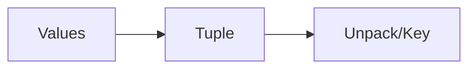

# Tuples

## Overview

- **What is it?** Tuples are ordered, immutable sequences often used for fixed records.
- **Why is it important?** Immutability makes tuples safe dictionary keys and return values.
- **Where is it used?** Coordinates, DB rows, function returns, config constants.

## Learning Objectives

- **Skills gained:** Practical command of Tuples.
- **Concepts covered:**

- Create tuples and unpack them.
- Use tuples as dict keys.
- Choose tuple vs list.

- **Expected outcome:** You model fixed-size records with tuples appropriately.

## Real World Applications

- GIS
- Finance ticks
- ORM rows
- Robotics state

- **Business applications:** Automate workflows, reduce manual errors, accelerate delivery.
- **Career relevance:** Required knowledge for Python roles from junior developer to senior engineer.

## Core Concepts

### Literals

- **Definition:** Parentheses or commas create tuples.
- **Visual explanation:** `Literals` → process → result
- **Practical example:**

```python
point = (10, 20)
print(point[0])
```

### Unpacking

- **Definition:** Assign elements to names.
- **Visual explanation:** `Unpacking` → process → result
- **Practical example:**

```python
x, y = (3, 4)
print(x + y)
```

### Immutability

- **Definition:** Cannot change length or items.
- **Visual explanation:** `Immutability` → process → result
- **Practical example:**

```python
t = (1, 2)
print(len(t))
```

## Infographic Summary

| Block | Summary |
| --- | --- |
| 📌 Concept | Tuples protect data from accidental mutation. |
| ⚡ Purpose | Represent small fixed structures. |
| 🔥 Benefits | Hashable, memory efficient, clear intent. |
| 🎯 Use Cases | RGB triples, lat/long, multi-return values. |
| 🚀 Best Practices | Use namedtuple or dataclass for many fields. |
| ❌ Common Mistakes | Trying to append, confusing single-element syntax, huge tuples. |

## Syntax Guide

### Basic Syntax

```python
rgb = (255, 128, 0)
print(rgb)
```

### Standard Structure

```python
pack values -> pass/store -> unpack/use
```

### Code Pattern

```python
name, score = get_result()
```

## Examples

### Beginner Example

```python
dims = (1920, 1080)
print(dims[0] * dims[1])
```

### Intermediate Example

```python
record = ('Ada', 36)
print(f'{record[0]} is {record[1]}')
```

### Advanced Example

```python
from collections import namedtuple

Point = namedtuple('Point', 'x y')
print(Point(1, 2)._asdict())
```

## Workflow Diagram



---
