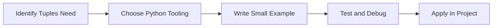

> **Level 1: Beginner** · Topic 18 of 35

[← List Methods](./17-list-methods.md) · [↑ Level index](../README.md) · [Sets →](./19-sets.md)

# Tuples

## Overview
- **What is it?** Tuples are ordered, immutable collections.
- **Why is it important?** Represent fixed records and safe grouped values.
- **Where is it used?** Software teams, education, automation, analytics, and backend development.

## Learning Objectives
- Gain the practical skill to explain, write, debug, and review tuples code.
- Cover the vocabulary, syntax, workflow, edge cases, and professional habits behind tuples.
- Expected outcome: you can use tuples in a small project and recognize when it belongs in production code.

## Real World Applications
- **Industry use cases:** Software teams, education, automation, analytics, and backend development.
- **Business applications:** Reduce manual work, improve reliability, support reporting, automate decisions, and ship maintainable features.
- **Career relevance:** Supports Python developer, backend engineer, data engineer, AI engineer, DevOps engineer, QA automation, and cybersecurity automation roles.

## Core Concepts

### Mental Model
- **Definition:** The main idea that gives tuples its structure and purpose inside a Python program.
- **Visual explanation:** `problem -> Tuples model -> clear code`
- **Practical example:**

```python
apply_tuples_label = "Tuples"
print(apply_tuples_label)
```

### Execution Flow
- **Definition:** The ordered steps Python follows when tuples code is created, executed, or integrated.
- **Visual explanation:** `input -> Python operation -> result -> feedback`
- **Practical example:**

```python
coordinates = (4, 8)
print(coordinates[0])
```

### Quality Rule
- **Definition:** The reliability habit that keeps tuples understandable, testable, secure, and maintainable.
- **Visual explanation:** `working code -> validation -> production confidence`
- **Practical example:**

```python
def min_max(values):
    return min(values), max(values)

low, high = min_max([3, 9, 1])
print(low, high)
```

## Infographic Summary

| Infographic Block | Key Message |
| --- | --- |
| 📌 Concept | Tuples belongs to the core programming foundation part of Python mastery. |
| ⚡ Purpose | Represent fixed records and safe grouped values. |
| 🔥 Benefits | Coordinates, database rows, function returns, and dictionary keys. |
| 🎯 Use Cases | Software teams, education, automation, analytics, and backend development. |
| 🚀 Best Practices | Prefer readable names, small examples, explicit errors, tests, documentation, and version-aware choices. |
| ❌ Common Mistakes | Copying code without understanding it, ignoring edge cases, skipping validation, and mixing unrelated responsibilities. |

## Syntax Guide

### Basic Syntax

```python
point = (10, 20)
x, y = point
```

### Standard Structure

```python
def apply_tuples(value):
    """Apply the Tuples concept to one value."""
    return value

result = apply_tuples("practice")
print(result)
```

### Code Pattern

```python
# 1. Identify the Tuples problem
# 2. Apply the correct Python structure
# 3. Validate the result with tests or output
```

## Examples

### Beginner Example

```python
coordinates = (4, 8)
print(coordinates[0])
```

### Intermediate Example

```python
def min_max(values):
    return min(values), max(values)

low, high = min_max([3, 9, 1])
print(low, high)
```

### Advanced Example

```python
from typing import NamedTuple

class Point(NamedTuple):
    x: int
    y: int

print(Point(2, 5))
```

## Workflow Diagram




---

---

[← List Methods](./17-list-methods.md) · [↑ Level index](../README.md) · [Sets →](./19-sets.md)
