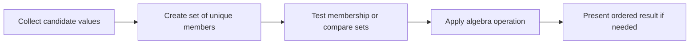

> **Level 1: Beginner** · Topic 19 of 35

[← Tuples](./18-tuples.md) · [↑ Level index](../README.md) · [Dictionaries →](./20-dictionaries.md)

# Sets

## Overview
- **What is it?** A set is a mutable, unordered collection of unique hashable elements.
- **Why is it important?** Sets remove duplicates and provide fast membership plus union, intersection, and difference operations.
- **Where is it used?** Permissions, tags, unique identifiers, and comparisons between groups are natural set use cases.

## Learning Objectives
- Create non-empty and empty sets correctly.
- Add, remove, and test unique elements.
- Apply union, intersection, difference, and subset operations.

## Real World Applications
- Deduplicate imported labels.
- Find shared skills or missing permissions.
- Track identifiers already processed.

## Core Concepts

### Uniqueness and membership
- **Definition:** Adding an equal element has no effect, and membership does not depend on a visible position.
- **Visual explanation:** `many repeated values -> set -> unique values`
- **Practical example:**

```python
tags = {"python", "beginner", "python"}
print(len(tags), "python" in tags)
```

### Set algebra
- **Definition:** Union combines members, intersection keeps shared members, and difference keeps members found only on the left.
- **Visual explanation:** `A | B union; A & B shared; A - B left only`
- **Practical example:**

```python
team_a = {"Ana", "Bo"}
team_b = {"Bo", "Cy"}
print(team_a | team_b, team_a & team_b, team_a - team_b)
```

### Hashable elements
- **Definition:** Set members must have stable hashes, so immutable values such as strings and tuples work but lists do not.
- **Visual explanation:** `hashable value -> set member`
- **Practical example:**

```python
visited = {("row1", 2), ("row2", 4)}
visited.add(("row3", 1))
print(visited)
```

## Infographic Summary

| Infographic Block | Topic-Specific Takeaway |
| --- | --- |
| 📌 Concept | A set is a mutable, unordered collection of unique hashable elements. |
| ⚡ Purpose | Represent unique values and compare groups with membership and set algebra. |
| 🔥 Benefits | Sets remove duplicates and provide fast membership plus union, intersection, and difference operations. |
| 🎯 Use Cases | Permissions, tags, unique identifiers, and comparisons between groups are natural set use cases. |
| 🚀 Best Practices | Use `set()` for an empty set and sort only when presentation requires deterministic order. |
| ❌ Common Mistakes | Writing `{}` for an empty set; that literal creates an empty dictionary. |

## Syntax Guide

### Basic Syntax

```python
unique_scores = set([80, 90, 80, 75])
print(unique_scores)
```

### Standard Structure

```python
required = {"read", "write"}
granted = {"read", "share"}
missing = required - granted
print(missing)
```

### Code Pattern

```python
enrolled = {"Ada", "Ben", "Chao"}
completed = {"Ada", "Chao", "Dina"}
print("Completed and enrolled:", enrolled & completed)
print("Still pending:", enrolled - completed)
print("All known learners:", enrolled | completed)
```

## Examples

### Beginner Example

```python
colors = {"red", "blue"}
colors.add("green")
print("green" in colors)
```

### Intermediate Example

```python
raw_ids = [101, 102, 101, 103]
unique_ids = set(raw_ids)
print(len(raw_ids) - len(unique_ids), "duplicate(s)")
```

### Advanced Example

```python
required_skills = {"python", "git", "sql"}
candidate_skills = {"python", "git", "linux"}
coverage = required_skills & candidate_skills
gaps = required_skills - candidate_skills
qualified = required_skills <= candidate_skills
print(coverage, gaps, qualified)
```

## Workflow Diagram



---

[← Tuples](./18-tuples.md) · [↑ Level index](../README.md) · [Dictionaries →](./20-dictionaries.md)
