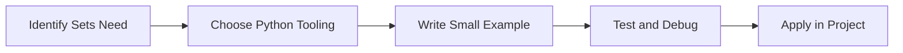

> **Level 1: Beginner** · Topic 19 of 35

[← Tuples](./18-tuples.md) · [↑ Level index](../README.md) · [Dictionaries →](./20-dictionaries.md)

# Sets

## Overview
- **What is it?** Sets are unordered collections of unique values.
- **Why is it important?** Remove duplicates and perform membership or mathematical set operations.
- **Where is it used?** Software teams, education, automation, analytics, and backend development.

## Learning Objectives
- Gain the practical skill to explain, write, debug, and review sets code.
- Cover the vocabulary, syntax, workflow, edge cases, and professional habits behind sets.
- Expected outcome: you can use sets in a small project and recognize when it belongs in production code.

## Real World Applications
- **Industry use cases:** Software teams, education, automation, analytics, and backend development.
- **Business applications:** Reduce manual work, improve reliability, support reporting, automate decisions, and ship maintainable features.
- **Career relevance:** Supports Python developer, backend engineer, data engineer, AI engineer, DevOps engineer, QA automation, and cybersecurity automation roles.

## Core Concepts

### Mental Model
- **Definition:** The main idea that gives sets its structure and purpose inside a Python program.
- **Visual explanation:** `problem -> Sets model -> clear code`
- **Practical example:**

```python
apply_sets_label = "Sets"
print(apply_sets_label)
```

### Execution Flow
- **Definition:** The ordered steps Python follows when sets code is created, executed, or integrated.
- **Visual explanation:** `input -> Python operation -> result -> feedback`
- **Practical example:**

```python
names = {"Ada", "Ada", "Lin"}
print(names)
```

### Quality Rule
- **Definition:** The reliability habit that keeps sets understandable, testable, secure, and maintainable.
- **Visual explanation:** `working code -> validation -> production confidence`
- **Practical example:**

```python
required = {"python", "git"}
known = {"python", "sql", "git"}
print(required <= known)
```

## Infographic Summary

| Infographic Block | Key Message |
| --- | --- |
| 📌 Concept | Sets belongs to the core programming foundation part of Python mastery. |
| ⚡ Purpose | Remove duplicates and perform membership or mathematical set operations. |
| 🔥 Benefits | Access checks, tag comparisons, deduplication, and matching. |
| 🎯 Use Cases | Software teams, education, automation, analytics, and backend development. |
| 🚀 Best Practices | Prefer readable names, small examples, explicit errors, tests, documentation, and version-aware choices. |
| ❌ Common Mistakes | Copying code without understanding it, ignoring edge cases, skipping validation, and mixing unrelated responsibilities. |

## Syntax Guide

### Basic Syntax

```python
skills = {"python", "sql"}
skills.add("git")
```

### Standard Structure

```python
def apply_sets(value):
    """Apply the Sets concept to one value."""
    return value

result = apply_sets("practice")
print(result)
```

### Code Pattern

```python
# 1. Identify the Sets problem
# 2. Apply the correct Python structure
# 3. Validate the result with tests or output
```

## Examples

### Beginner Example

```python
names = {"Ada", "Ada", "Lin"}
print(names)
```

### Intermediate Example

```python
required = {"python", "git"}
known = {"python", "sql", "git"}
print(required <= known)
```

### Advanced Example

```python
active_users = {1, 2, 3}
paid_users = {2, 3, 4}
print(active_users & paid_users)
```

## Workflow Diagram




---

---

[← Tuples](./18-tuples.md) · [↑ Level index](../README.md) · [Dictionaries →](./20-dictionaries.md)
