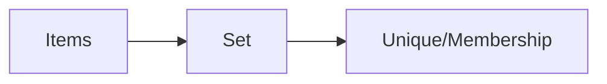

# Sets

## Overview

- **What is it?** Sets are unordered collections of unique hashable elements.
- **Why is it important?** They provide fast membership tests and set algebra.
- **Where is it used?** Tag systems, deduplication, permission unions, graph nodes.

## Learning Objectives

- **Skills gained:** Practical command of Sets.
- **Concepts covered:**

- Create sets and test membership.
- Apply union, intersection, difference.
- Use set comprehensions.

- **Expected outcome:** You deduplicate and compare collections with sets.

## Real World Applications

- Ad targeting
- Security IOC lists
- Catalog tags
- Graph analytics

- **Business applications:** Automate workflows, reduce manual errors, accelerate delivery.
- **Career relevance:** Required knowledge for Python roles from junior developer to senior engineer.

## Core Concepts

### Literals

- **Definition:** Curly braces or set() constructor.
- **Visual explanation:** `Literals` → process → result
- **Practical example:**

```python
tags = {'python', 'web'}
print('python' in tags)
```

### Uniqueness

- **Definition:** Duplicates are ignored.
- **Visual explanation:** `Uniqueness` → process → result
- **Practical example:**

```python
print(set([1, 1, 2]))
```

### Algebra

- **Definition:** Union and intersection ops.
- **Visual explanation:** `Algebra` → process → result
- **Practical example:**

```python
a = {1, 2}
b = {2, 3}
print(a & b)
```

## Infographic Summary

| Block | Summary |
| --- | --- |
| 📌 Concept | Sets enforce uniqueness with hash-based lookup. |
| ⚡ Purpose | Track distinct items and relationships. |
| 🔥 Benefits | O(1) average membership, expressive operators. |
| 🎯 Use Cases | Unique visitors, skill tags, anomaly detection. |
| 🚀 Best Practices | Use frozenset for immutable sets; beware unhashable elements. |
| ❌ Common Mistakes | Using {} for empty set, relying on order, set of lists. |

## Syntax Guide

### Basic Syntax

```python
seen = set()
seen.add('a')
print(seen)
```

### Standard Structure

```python
build set -> membership/ops -> consume
```

### Code Pattern

```python
unique = set(items)
print(len(unique))
```

## Examples

### Beginner Example

```python
print(set('hello'))
```

### Intermediate Example

```python
required = {'read', 'write'}
granted = {'read'}
print(required <= granted)
```

### Advanced Example

```python
def jaccard(a: set[str], b: set[str]) -> float:
    return len(a & b) / len(a | b)


print(jaccard({'a', 'b'}, {'b', 'c'}))
```

## Workflow Diagram



---
