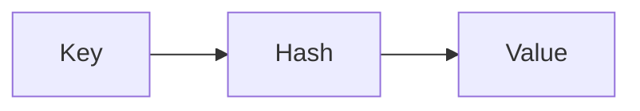

# Dictionaries

## Overview

- **What is it?** Dictionaries map hashable keys to values for fast lookup.
- **Why is it important?** Key-value storage models records, caches, and indexes naturally.
- **Where is it used?** JSON-like data, configs, memoization, frequency counts.

## Learning Objectives

- **Skills gained:** Practical command of Dictionaries.
- **Concepts covered:**

- Create, access, and update dicts.
- Iterate keys, values, items.
- Use get and setdefault safely.

- **Expected outcome:** You structure associative data with dictionaries.

## Real World Applications

- API payloads
- Session stores
- Feature flags
- Word counts

- **Business applications:** Automate workflows, reduce manual errors, accelerate delivery.
- **Career relevance:** Required knowledge for Python roles from junior developer to senior engineer.

## Core Concepts

### Literals

- **Definition:** Key:value pairs in braces.
- **Visual explanation:** `Literals` → process → result
- **Practical example:**

```python
user = {'name': 'Ada'}
print(user['name'])
```

### get

- **Definition:** Safe lookup with default.
- **Visual explanation:** `get` → process → result
- **Practical example:**

```python
print({'a': 1}.get('b', 0))
```

### items

- **Definition:** Iterate key-value pairs.
- **Visual explanation:** `items` → process → result
- **Practical example:**

```python
for k, v in {'x': 1}.items():
    print(k, v)
```

## Infographic Summary

| Block | Summary |
| --- | --- |
| 📌 Concept | Dicts are hash tables mapping keys to values. |
| ⚡ Purpose | Associate labels with data for O(1) lookup. |
| 🔥 Benefits | Flexible schema, fast access, JSON-like. |
| 🎯 Use Cases | HTTP headers, tallies, object caches. |
| 🚀 Best Practices | Use dict comprehensions; avoid mutating while iterating. |
| ❌ Common Mistakes | KeyError on missing keys, unhashable keys, relying on order before 3.7 mentally. |

## Syntax Guide

### Basic Syntax

```python
scores = {'Ada': 98, 'Lin': 87}
print(scores['Ada'])
```

### Standard Structure

```python
build -> lookup/update -> iterate
```

### Code Pattern

```python
count = {}
for word in words:
    count[word] = count.get(word, 0) + 1
```

## Examples

### Beginner Example

```python
capitals = {'FR': 'Paris'}
print(capitals.get('FR'))
```

### Intermediate Example

```python
rows = [{'id': 1, 'name': 'Ada'}, {'id': 2, 'name': 'Lin'}]
by_id = {r['id']: r for r in rows}
print(by_id[2])
```

### Advanced Example

```python
from collections import defaultdict

dd = defaultdict(list)
for dept, name in [('eng', 'Ada'), ('eng', 'Lin')]:
    dd[dept].append(name)
print(dict(dd))
```

## Workflow Diagram



---
