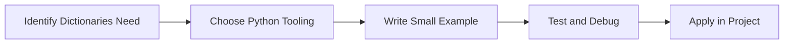

> **Level 1: Beginner** · Topic 20 of 35

[← Sets](./19-sets.md) · [↑ Level index](../README.md) · [Functions →](./21-functions.md)

# Dictionaries

## Overview
- **What is it?** Dictionaries map keys to values.
- **Why is it important?** Represent structured records and fast lookups.
- **Where is it used?** Software teams, education, automation, analytics, and backend development.

## Learning Objectives
- Gain the practical skill to explain, write, debug, and review dictionaries code.
- Cover the vocabulary, syntax, workflow, edge cases, and professional habits behind dictionaries.
- Expected outcome: you can use dictionaries in a small project and recognize when it belongs in production code.

## Real World Applications
- **Industry use cases:** Software teams, education, automation, analytics, and backend development.
- **Business applications:** Reduce manual work, improve reliability, support reporting, automate decisions, and ship maintainable features.
- **Career relevance:** Supports Python developer, backend engineer, data engineer, AI engineer, DevOps engineer, QA automation, and cybersecurity automation roles.

## Core Concepts

### Mental Model
- **Definition:** The main idea that gives dictionaries its structure and purpose inside a Python program.
- **Visual explanation:** `problem -> Dictionaries model -> clear code`
- **Practical example:**

```python
apply_dictionaries_label = "Dictionaries"
print(apply_dictionaries_label)
```

### Execution Flow
- **Definition:** The ordered steps Python follows when dictionaries code is created, executed, or integrated.
- **Visual explanation:** `input -> Python operation -> result -> feedback`
- **Practical example:**

```python
profile = {"name": "Lin", "age": 29}
print(profile["name"])
```

### Quality Rule
- **Definition:** The reliability habit that keeps dictionaries understandable, testable, secure, and maintainable.
- **Visual explanation:** `working code -> validation -> production confidence`
- **Practical example:**

```python
inventory = {"laptop": 3, "mouse": 10}
inventory["laptop"] -= 1
print(inventory)
```

## Infographic Summary

| Infographic Block | Key Message |
| --- | --- |
| 📌 Concept | Dictionaries belongs to the core programming foundation part of Python mastery. |
| ⚡ Purpose | Represent structured records and fast lookups. |
| 🔥 Benefits | JSON-like data, caches, configurations, indexes, and API payloads. |
| 🎯 Use Cases | Software teams, education, automation, analytics, and backend development. |
| 🚀 Best Practices | Prefer readable names, small examples, explicit errors, tests, documentation, and version-aware choices. |
| ❌ Common Mistakes | Copying code without understanding it, ignoring edge cases, skipping validation, and mixing unrelated responsibilities. |

## Syntax Guide

### Basic Syntax

```python
user = {"name": "Ada", "role": "admin"}
print(user["name"])
```

### Standard Structure

```python
def apply_dictionaries(value):
    """Apply the Dictionaries concept to one value."""
    return value

result = apply_dictionaries("practice")
print(result)
```

### Code Pattern

```python
# 1. Identify the Dictionaries problem
# 2. Apply the correct Python structure
# 3. Validate the result with tests or output
```

## Examples

### Beginner Example

```python
profile = {"name": "Lin", "age": 29}
print(profile["name"])
```

### Intermediate Example

```python
inventory = {"laptop": 3, "mouse": 10}
inventory["laptop"] -= 1
print(inventory)
```

### Advanced Example

```python
from collections import defaultdict

counts = defaultdict(int)
for word in ["api", "db", "api"]:
    counts[word] += 1
print(dict(counts))
```

## Workflow Diagram




---

---

[← Sets](./19-sets.md) · [↑ Level index](../README.md) · [Functions →](./21-functions.md)
