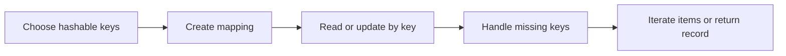

> **Level 1: Beginner** · Topic 20 of 35

[← Sets](./19-sets.md) · [↑ Level index](../README.md) · [Functions →](./21-functions.md)

# Dictionaries

## Overview
- **What is it?** A dictionary is a mutable mapping from unique hashable keys to values.
- **Why is it important?** Key-based access models named fields and provides direct lookup without searching every item.
- **Where is it used?** Profiles, configuration, counters, indexes, and structured records commonly use dictionaries.

## Learning Objectives
- Create, read, add, update, and delete key-value pairs.
- Use `get`, membership, and iteration safely.
- Build counters and nested records with clear key choices.

## Real World Applications
- Represent a user or product record.
- Count occurrences by category.
- Look up configuration or inventory by name.

## Core Concepts

### Key-value mapping
- **Definition:** Each unique key maps to one value; assigning an existing key replaces its value.
- **Visual explanation:** `key -> value, key -> value`
- **Practical example:**

```python
student = {"name": "Ivy", "score": 88}
student["score"] = 91
print(student["name"], student["score"])
```

### Safe lookup
- **Definition:** `key in mapping` tests existence, while `get` returns a default instead of raising `KeyError` for a missing key.
- **Visual explanation:** `requested key -> found value or chosen default`
- **Practical example:**

```python
stock = {"pens": 12}
print(stock.get("books", 0))
```

### Dictionary iteration
- **Definition:** Iteration can expose keys, values, or key-value pairs through `keys`, `values`, or `items`.
- **Visual explanation:** `mapping.items -> key value pairs`
- **Practical example:**

```python
prices = {"tea": 2.5, "cake": 4.0}
for item, price in prices.items():
    print(item, price)
```

## Infographic Summary

| Infographic Block | Topic-Specific Takeaway |
| --- | --- |
| 📌 Concept | A dictionary is a mutable mapping from unique hashable keys to values. |
| ⚡ Purpose | Associate unique keys with values for structured records and direct lookup. |
| 🔥 Benefits | Key-based access models named fields and provides direct lookup without searching every item. |
| 🎯 Use Cases | Profiles, configuration, counters, indexes, and structured records commonly use dictionaries. |
| 🚀 Best Practices | Use stable meaningful keys, test optional keys explicitly, and avoid deeply nested records when a class would be clearer. |
| ❌ Common Mistakes | Indexing an optional key directly and allowing a preventable `KeyError`. |

## Syntax Guide

### Basic Syntax

```python
book = {"title": "Python 101", "pages": 240}
print(book["title"])
```

### Standard Structure

```python
inventory = {"pen": 10}
inventory["book"] = 4
inventory["pen"] -= 1
print(inventory.get("eraser", 0), inventory)
```

### Code Pattern

```python
words = ["red", "blue", "red", "green", "blue", "red"]
counts = {}
for word in words:
    counts[word] = counts.get(word, 0) + 1
print(counts)
```

## Examples

### Beginner Example

```python
profile = {"name": "Luz", "active": True}
print(profile["name"])
```

### Intermediate Example

```python
settings = {"theme": "dark", "notifications": True}
for key, value in settings.items():
    print(f"{key}={value}")
```

### Advanced Example

```python
orders = [
    {"product": "pen", "quantity": 2},
    {"product": "book", "quantity": 1},
    {"product": "pen", "quantity": 3},
]
totals = {}
for order in orders:
    product = order["product"]
    totals[product] = totals.get(product, 0) + order["quantity"]
print(totals)
```

## Workflow Diagram



---

[← Sets](./19-sets.md) · [↑ Level index](../README.md) · [Functions →](./21-functions.md)
