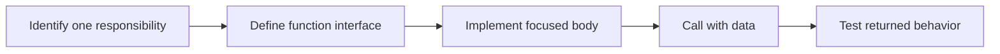

> **Level 1: Beginner** · Topic 21 of 35

[← Dictionaries](./20-dictionaries.md) · [↑ Level index](../README.md) · [Arguments and Parameters →](./22-arguments-and-parameters.md)

# Functions

## Overview
- **What is it?** A function is a named reusable block defined with `def` and executed when it is called.
- **Why is it important?** Functions isolate responsibilities, reduce duplication, and make behavior easier to test.
- **Where is it used?** Programs organize calculations, validation, transformations, and workflows into functions.

## Learning Objectives
- Define and call a function.
- Separate a function's interface from its implementation.
- Keep functions focused and document behavior with names and docstrings.

## Real World Applications
- Reuse a price calculation in several places.
- Hide validation details behind a clear operation.
- Test a unit of behavior independently.

## Core Concepts

### Definition and call
- **Definition:** A `def` statement creates a function object; a call expression runs its body.
- **Visual explanation:** `def -> function object; name() -> execute body`
- **Practical example:**

```python
def say_hello():
    print("Hello")

say_hello()
```

### Function interface
- **Definition:** The name, parameters, and returned result form an interface callers can use without knowing each internal step.
- **Visual explanation:** `arguments -> function boundary -> result`
- **Practical example:**

```python
def area(width, height):
    return width * height

print(area(4, 3))
```

### Single responsibility
- **Definition:** A focused function performs one coherent task, making naming, testing, and reuse straightforward.
- **Visual explanation:** `one purpose -> small function -> predictable behavior`
- **Practical example:**

```python
def is_valid_score(score):
    return 0 <= score <= 100

print(is_valid_score(84))
```

## Infographic Summary

| Infographic Block | Topic-Specific Takeaway |
| --- | --- |
| 📌 Concept | A function is a named reusable block defined with `def` and executed when it is called. |
| ⚡ Purpose | Package one focused behavior behind a reusable name and interface. |
| 🔥 Benefits | Functions isolate responsibilities, reduce duplication, and make behavior easier to test. |
| 🎯 Use Cases | Programs organize calculations, validation, transformations, and workflows into functions. |
| 🚀 Best Practices | Use verb-based names, keep side effects visible, and split a function when its description needs the word 'and'. |
| ❌ Common Mistakes | Defining a function but forgetting to call it, or mixing input, calculation, and printing into every function. |

## Syntax Guide

### Basic Syntax

```python
def greet():
    print("Welcome!")

greet()
```

### Standard Structure

```python
def rectangle_area(width, height):
    return width * height

area = rectangle_area(5, 8)
print(area)
```

### Code Pattern

```python
def summarize_scores(scores):
    if not scores:
        return {"count": 0, "average": None}
    return {
        "count": len(scores),
        "average": sum(scores) / len(scores),
    }

print(summarize_scores([75, 88, 92]))
```

## Examples

### Beginner Example

```python
def announce():
    print("Lesson started")

announce()
```

### Intermediate Example

```python
def final_price(subtotal, tax_rate=0.08):
    return subtotal * (1 + tax_rate)

print(f"${final_price(50):.2f}")
```

### Advanced Example

```python
def partition_even(numbers):
    even = []
    odd = []
    for number in numbers:
        target = even if number % 2 == 0 else odd
        target.append(number)
    return even, odd

print(partition_even([1, 2, 3, 4, 5]))
```

## Workflow Diagram



---

[← Dictionaries](./20-dictionaries.md) · [↑ Level index](../README.md) · [Arguments and Parameters →](./22-arguments-and-parameters.md)
