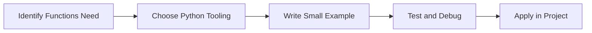

> **Level 1: Beginner** · Topic 21 of 35

[← Dictionaries](./20-dictionaries.md) · [↑ Level index](../README.md) · [Arguments and Parameters →](./22-arguments-and-parameters.md)

# Functions

## Overview
- **What is it?** Functions package reusable behavior behind a name.
- **Why is it important?** Reduce duplication and make programs easier to test.
- **Where is it used?** Software teams, education, automation, analytics, and backend development.

## Learning Objectives
- Gain the practical skill to explain, write, debug, and review functions code.
- Cover the vocabulary, syntax, workflow, edge cases, and professional habits behind functions.
- Expected outcome: you can use functions in a small project and recognize when it belongs in production code.

## Real World Applications
- **Industry use cases:** Software teams, education, automation, analytics, and backend development.
- **Business applications:** Reduce manual work, improve reliability, support reporting, automate decisions, and ship maintainable features.
- **Career relevance:** Supports Python developer, backend engineer, data engineer, AI engineer, DevOps engineer, QA automation, and cybersecurity automation roles.

## Core Concepts

### Mental Model
- **Definition:** The main idea that gives functions its structure and purpose inside a Python program.
- **Visual explanation:** `problem -> Functions model -> clear code`
- **Practical example:**

```python
apply_functions_label = "Functions"
print(apply_functions_label)
```

### Execution Flow
- **Definition:** The ordered steps Python follows when functions code is created, executed, or integrated.
- **Visual explanation:** `input -> Python operation -> result -> feedback`
- **Practical example:**

```python
def greet(name):
    print(f"Hello, {name}")

greet("Ada")
```

### Quality Rule
- **Definition:** The reliability habit that keeps functions understandable, testable, secure, and maintainable.
- **Visual explanation:** `working code -> validation -> production confidence`
- **Practical example:**

```python
def calculate_total(subtotal: float, tax_rate: float = 0.08) -> float:
    return subtotal * (1 + tax_rate)

print(calculate_total(100))
```

## Infographic Summary

| Infographic Block | Key Message |
| --- | --- |
| 📌 Concept | Functions belongs to the core programming foundation part of Python mastery. |
| ⚡ Purpose | Reduce duplication and make programs easier to test. |
| 🔥 Benefits | Business rules, utilities, service layers, and libraries. |
| 🎯 Use Cases | Software teams, education, automation, analytics, and backend development. |
| 🚀 Best Practices | Prefer readable names, small examples, explicit errors, tests, documentation, and version-aware choices. |
| ❌ Common Mistakes | Copying code without understanding it, ignoring edge cases, skipping validation, and mixing unrelated responsibilities. |

## Syntax Guide

### Basic Syntax

```python
def add(left, right):
    return left + right
```

### Standard Structure

```python
def apply_functions(value):
    """Apply the Functions concept to one value."""
    return value

result = apply_functions("practice")
print(result)
```

### Code Pattern

```python
# 1. Identify the Functions problem
# 2. Apply the correct Python structure
# 3. Validate the result with tests or output
```

## Examples

### Beginner Example

```python
def greet(name):
    print(f"Hello, {name}")

greet("Ada")
```

### Intermediate Example

```python
def calculate_total(subtotal: float, tax_rate: float = 0.08) -> float:
    return subtotal * (1 + tax_rate)

print(calculate_total(100))
```

### Advanced Example

```python
from functools import lru_cache

@lru_cache(maxsize=128)
def fibonacci(n: int) -> int:
    return n if n < 2 else fibonacci(n - 1) + fibonacci(n - 2)

print(fibonacci(10))
```

## Workflow Diagram




---

---

[← Dictionaries](./20-dictionaries.md) · [↑ Level index](../README.md) · [Arguments and Parameters →](./22-arguments-and-parameters.md)
