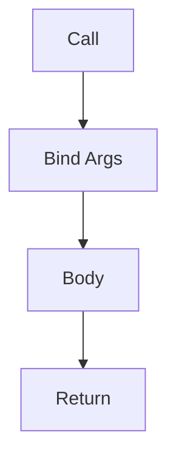

# Functions

## Overview

- **What is it?** Functions are reusable blocks of code that perform a task and optionally return a value.
- **Why is it important?** They reduce duplication and organize logic into testable units.
- **Where is it used?** API handlers, data transforms, CLI tools, ML training loops.

## Learning Objectives

- **Skills gained:** Practical command of Functions.
- **Concepts covered:**

- Define and call functions.
- Use parameters and return values.
- Apply default and keyword arguments.

- **Expected outcome:** You structure programs into composable functions.

## Real World Applications

- Backend services
- Data engineering
- Test automation
- Quant libraries

- **Business applications:** Automate workflows, reduce manual errors, accelerate delivery.
- **Career relevance:** Required knowledge for Python roles from junior developer to senior engineer.

## Core Concepts

### def

- **Definition:** Keyword to define a function.
- **Visual explanation:** `def` → process → result
- **Practical example:**

```python
def greet(name):
    return f'Hi {name}'
print(greet('Ada'))
```

### Parameters

- **Definition:** Inputs declared in the definition.
- **Visual explanation:** `Parameters` → process → result
- **Practical example:**

```python
def add(a, b):
    return a + b
print(add(2, 3))
```

### Return

- **Definition:** Sends a result back to the caller.
- **Visual explanation:** `Return` → process → result
- **Practical example:**

```python
def double(n):
    return n * 2
print(double(4))
```

## Infographic Summary

| Block | Summary |
| --- | --- |
| 📌 Concept | Functions encapsulate behavior with a clear interface. |
| ⚡ Purpose | Reuse logic and improve maintainability. |
| 🔥 Benefits | Testability, readability, modularity. |
| 🎯 Use Cases | Validation, formatting, API clients, business rules. |
| 🚀 Best Practices | Single responsibility, type hints, docstrings. |
| ❌ Common Mistakes | Side effects in pure helpers, too many parameters. |

## Syntax Guide

### Basic Syntax

```python
def double(n):
    return n * 2
```

### Standard Structure

```python
def name(params):
    body
    return result
```

### Code Pattern

```python
def process(data):
    return transform(clean(data))
```

## Examples

### Beginner Example

```python
def greet(name):
    print(f'Hello, {name}')

greet('World')
```

### Intermediate Example

```python
def summarize(numbers: list[float]) -> dict[str, float]:
    return {"count": len(numbers), "total": sum(numbers)}


print(summarize([1.5, 2.5, 3.0]))
```

### Advanced Example

```python
from functools import wraps


def log_calls(func):
    @wraps(func)
    def wrapper(*args, **kwargs):
        result = func(*args, **kwargs)
        print(func.__name__, 'called')
        return result

    return wrapper


@log_calls
def add(a, b):
    return a + b


print(add(1, 2))
```

## Workflow Diagram



---
