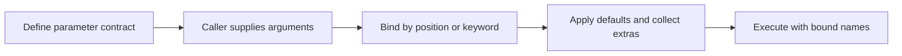

> **Level 1: Beginner** · Topic 22 of 35

[← Functions](./21-functions.md) · [↑ Level index](../README.md) · [Return Statements →](./23-return-statements.md)

# Arguments and Parameters

## Overview
- **What is it?** Parameters are names in a function definition; arguments are the actual values supplied in a function call.
- **Why is it important?** They let one function operate on different data while expressing required, optional, and named inputs.
- **Where is it used?** APIs, calculations, formatting helpers, and reusable business rules all depend on clear function inputs.

## Learning Objectives
- Distinguish parameters from arguments.
- Use positional, keyword, and default arguments.
- Collect variable positional and keyword arguments only when the interface benefits.

## Real World Applications
- Configure a reusable notification function.
- Pass records into validation and calculation functions.
- Offer optional formatting without duplicating behavior.

## Core Concepts

### Parameters versus arguments
- **Definition:** A parameter receives a value inside the function; an argument is the expression supplied by the caller.
- **Visual explanation:** `call argument -> definition parameter -> function body`
- **Practical example:**

```python
def greet(name):
    print(f"Hello, {name}")

greet("Ada")
```

### Positional keyword and defaults
- **Definition:** Positional arguments match by order, keyword arguments match by name, and defaults fill omitted optional values.
- **Visual explanation:** `call bindings -> named parameters -> body`
- **Practical example:**

```python
def power(base, exponent=2):
    return base ** exponent

print(power(3), power(base=2, exponent=5))
```

### Variable argument collections
- **Definition:** `*args` gathers extra positional arguments into a tuple; `**kwargs` gathers extra keywords into a dictionary.
- **Visual explanation:** `many call inputs -> args tuple + kwargs dict`
- **Practical example:**

```python
def describe(*items, **details):
    return {"items": items, "details": details}

print(describe("pen", "book", owner="Mira"))
```

## Infographic Summary

| Infographic Block | Topic-Specific Takeaway |
| --- | --- |
| 📌 Concept | Parameters are names in a function definition; arguments are the actual values supplied in a function call. |
| ⚡ Purpose | Supply required and optional inputs to reusable functions. |
| 🔥 Benefits | They let one function operate on different data while expressing required, optional, and named inputs. |
| 🎯 Use Cases | APIs, calculations, formatting helpers, and reusable business rules all depend on clear function inputs. |
| 🚀 Best Practices | Keep required parameters first, use keyword calls for meaning, and avoid mutable objects as default values. |
| ❌ Common Mistakes | Using a list or dictionary as a default parameter and unintentionally sharing it across calls. |

## Syntax Guide

### Basic Syntax

```python
def add(left, right):
    return left + right

print(add(4, 6))
```

### Standard Structure

```python
def label(name, prefix="Student"):
    return f"{prefix}: {name}"

print(label("Nia"))
print(label("Omar", prefix="Mentor"))
```

### Code Pattern

```python
def build_profile(name, *skills, active=True, **details):
    return {
        "name": name,
        "skills": list(skills),
        "active": active,
        "details": details,
    }

print(build_profile("Nia", "Python", "SQL", city="Accra"))
```

## Examples

### Beginner Example

```python
def multiply(a, b):
    return a * b

print(multiply(3, 7))
```

### Intermediate Example

```python
def create_email(user, domain="example.com"):
    return f"{user}@{domain}"

print(create_email("learner"))
print(create_email(user="admin", domain="school.org"))
```

### Advanced Example

```python
def total_cost(*prices, discount=0):
    subtotal = sum(prices)
    return subtotal * (1 - discount)

print(total_cost(12.0, 8.5, 4.0, discount=0.10))
```

## Workflow Diagram



---

[← Functions](./21-functions.md) · [↑ Level index](../README.md) · [Return Statements →](./23-return-statements.md)
