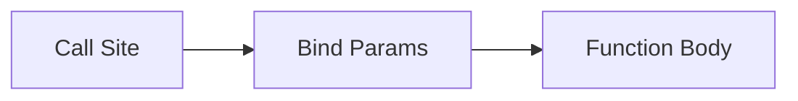

# Arguments and Parameters

## Overview

- **What is it?** Parameters define what a function accepts; arguments are the values passed in.
- **Why is it important?** Flexible signatures support optional config, variadic input, and readable call sites.
- **Where is it used?** Library APIs, frameworks, decorators, CLI wrappers.

## Learning Objectives

- **Skills gained:** Practical command of Arguments and Parameters.
- **Concepts covered:**

- Use positional and keyword parameters.
- Apply *args and **kwargs.
- Avoid mutable default arguments.

- **Expected outcome:** You design function signatures that are safe and expressive.

## Real World Applications

- SDK design
- Web frameworks
- Plugin systems
- Testing utilities

- **Business applications:** Automate workflows, reduce manual errors, accelerate delivery.
- **Career relevance:** Required knowledge for Python roles from junior developer to senior engineer.

## Core Concepts

### Defaults

- **Definition:** Parameters with fallback values.
- **Visual explanation:** `Defaults` → process → result
- **Practical example:**

```python
def connect(timeout=30):
    return timeout
print(connect())
```

### Keyword args

- **Definition:** Call by name for clarity.
- **Visual explanation:** `Keyword args` → process → result
- **Practical example:**

```python
def plot(x, y, color='blue'):
    return (x, y, color)
print(plot(1, 2, color='red'))
```

### *args/**kwargs

- **Definition:** Collect extra positional/keyword args.
- **Visual explanation:** `*args/**kwargs` → process → result
- **Practical example:**

```python
def wrap(*args, **kwargs):
    return (args, kwargs)
print(wrap(1, z=2))
```

## Infographic Summary

| Block | Summary |
| --- | --- |
| 📌 Concept | Binding maps arguments to parameters at call time. |
| ⚡ Purpose | Let functions accept varying inputs cleanly. |
| 🔥 Benefits | Readable calls, extensibility, wrapper-friendly. |
| 🎯 Use Cases | Decorators, logging wrappers, optional flags. |
| 🚀 Best Practices | Keyword-only for bool flags; immutable defaults; type hints. |
| ❌ Common Mistakes | Mutable defaults, overusing **kwargs, unclear parameter order. |

## Syntax Guide

### Basic Syntax

```python
def power(base, exp=2):
    return base ** exp
```

### Standard Structure

```python
define params -> bind at call -> execute
```

### Code Pattern

```python
def create_user(name, *, active=True):
    return {'name': name, 'active': active}
```

## Examples

### Beginner Example

```python
def greet(name, punctuation='!'):
    print(f'Hello, {name}{punctuation}')

greet('Ada')
```

### Intermediate Example

```python
def tag(*labels, **meta):
    return {'labels': labels, 'meta': meta}


print(tag('py', 'web', year=2026))
```

### Advanced Example

```python
from typing import Callable


def twice(func: Callable[[int], int], value: int) -> int:
    return func(func(value))


print(twice(lambda x: x + 1, 3))
```

## Workflow Diagram



---
