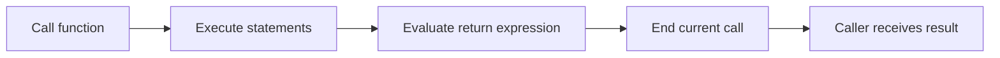

> **Level 1: Beginner** · Topic 23 of 35

[← Arguments and Parameters](./22-arguments-and-parameters.md) · [↑ Level index](../README.md) · [Scope →](./24-scope.md)

# Return Statements

## Overview
- **What is it?** A `return` statement ends a function call and sends a result object back to its caller.
- **Why is it important?** Returning data separates computation from display and lets callers compose, store, or test results.
- **Where is it used?** Calculators, parsers, searches, and transformations return values for later decisions.

## Learning Objectives
- Return a computed value and capture it at the call site.
- Use early returns for guard cases.
- Explain implicit `None` and tuple packing for multiple results.

## Real World Applications
- Compute a subtotal for a receipt.
- Return a matching record from a search.
- Report both minimum and maximum values.

## Core Concepts

### Result transfer
- **Definition:** `return expression` evaluates the expression, ends the call, and makes the value become the call expression's result.
- **Visual explanation:** `function body -> return value -> caller`
- **Practical example:**

```python
def double(number):
    return number * 2

result = double(6)
print(result)
```

### Early return
- **Definition:** A return can handle an exceptional condition immediately, preventing the remaining body from running.
- **Visual explanation:** `guard true -> return now; false -> normal path`
- **Practical example:**

```python
def divide(total, count):
    if count == 0:
        return None
    return total / count

print(divide(10, 0))
```

### Implicit None and multiple values
- **Definition:** A function reaching its end returns `None`; comma-separated return values are packed into a tuple.
- **Visual explanation:** `no return -> None; return a, b -> tuple`
- **Practical example:**

```python
def limits(values):
    return min(values), max(values)

low, high = limits([8, 3, 11])
print(low, high)
```

## Infographic Summary

| Infographic Block | Topic-Specific Takeaway |
| --- | --- |
| 📌 Concept | A `return` statement ends a function call and sends a result object back to its caller. |
| ⚡ Purpose | Send computed results from a function back to its caller. |
| 🔥 Benefits | Returning data separates computation from display and lets callers compose, store, or test results. |
| 🎯 Use Cases | Calculators, parsers, searches, and transformations return values for later decisions. |
| 🚀 Best Practices | Return useful data from logic functions and let the outer interaction layer decide how to print or store it. |
| ❌ Common Mistakes | Printing a value inside a function when the caller needs to receive and reuse that value. |

## Syntax Guide

### Basic Syntax

```python
def square(number):
    return number ** 2

print(square(5))
```

### Standard Structure

```python
def normalize(text):
    cleaned = text.strip()
    if not cleaned:
        return None
    return cleaned.title()

print(normalize("  ada  "))
```

### Code Pattern

```python
def statistics(values):
    if not values:
        return None
    return min(values), max(values), sum(values) / len(values)

result = statistics([4, 9, 2, 7])
if result is not None:
    low, high, average = result
    print(low, high, average)
```

## Examples

### Beginner Example

```python
def answer():
    return 42

value = answer()
print(value)
```

### Intermediate Example

```python
def find_even(numbers):
    for number in numbers:
        if number % 2 == 0:
            return number
    return None

print(find_even([3, 7, 10, 13]))
```

### Advanced Example

```python
def invoice_summary(prices, tax_rate):
    subtotal = sum(prices)
    tax = subtotal * tax_rate
    return {
        "subtotal": subtotal,
        "tax": tax,
        "total": subtotal + tax,
    }

summary = invoice_summary([12.5, 7.5], 0.08)
print(summary)
```

## Workflow Diagram



---

[← Arguments and Parameters](./22-arguments-and-parameters.md) · [↑ Level index](../README.md) · [Scope →](./24-scope.md)
