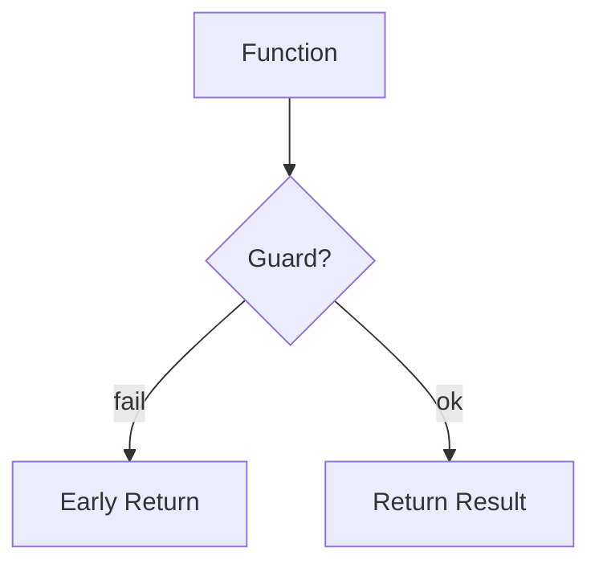

# Return Statements

## Overview

- **What is it?** return sends a value back to the caller and exits the function.
- **Why is it important?** Callers need results; early returns simplify control flow.
- **Where is it used?** Calculations, parsers, validators, service methods.

## Learning Objectives

- **Skills gained:** Practical command of Return Statements.
- **Concepts covered:**

- Return single and multiple values.
- Use early return for guards.
- Distinguish return vs print.

- **Expected outcome:** You write functions that communicate results clearly.

## Real World Applications

- Financial calculators
- Compilers
- Auth services
- Games

- **Business applications:** Automate workflows, reduce manual errors, accelerate delivery.
- **Career relevance:** Required knowledge for Python roles from junior developer to senior engineer.

## Core Concepts

### Single value

- **Definition:** Most common return form.
- **Visual explanation:** `Single value` → process → result
- **Practical example:**

```python
def sq(n):
    return n * n
print(sq(4))
```

### Tuple return

- **Definition:** Multiple values as one object.
- **Visual explanation:** `Tuple return` → process → result
- **Practical example:**

```python
def minmax(nums):
    return min(nums), max(nums)
print(minmax([3, 1, 2]))
```

### Early return

- **Definition:** Exit when precondition fails.
- **Visual explanation:** `Early return` → process → result
- **Practical example:**

```python
def safe_div(a, b):
    if b == 0:
        return None
    return a / b
print(safe_div(4, 2))
```

## Infographic Summary

| Block | Summary |
| --- | --- |
| 📌 Concept | return completes the function call expression. |
| ⚡ Purpose | Deliver outputs and stop execution when done. |
| 🔥 Benefits | Composable functions, clearer flow, testable outputs. |
| 🎯 Use Cases | Validation results, parsed tokens, status codes. |
| 🚀 Best Practices | Keep return types consistent; document None cases. |
| ❌ Common Mistakes | Returning print result, inconsistent types, missing return. |

## Syntax Guide

### Basic Syntax

```python
def add(a, b):
    return a + b
```

### Standard Structure

```python
compute -> optionally early exit -> return
```

### Code Pattern

```python
if not valid(x):
    return None
return transform(x)
```

## Examples

### Beginner Example

```python
def is_even(n):
    return n % 2 == 0
print(is_even(4))
```

### Intermediate Example

```python
def partition(nums, pivot):
    low = [n for n in nums if n < pivot]
    high = [n for n in nums if n >= pivot]
    return low, high
print(partition([3, 1, 4, 2], 3))
```

### Advanced Example

```python
from typing import Optional


def find_user(users: list[dict], user_id: int) -> Optional[dict]:
    for user in users:
        if user.get('id') == user_id:
            return user
    return None


print(find_user([{'id': 1}], 1))
```

## Workflow Diagram



---
