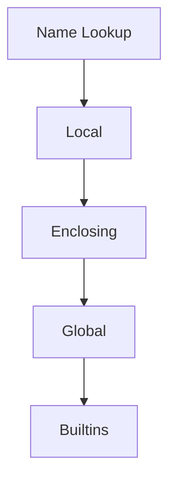

# Scope

## Overview

- **What is it?** Scope determines where names are visible: local, enclosing, global, or builtin (LEGB).
- **Why is it important?** Understanding scope prevents accidental shadowing and mutation bugs.
- **Where is it used?** Closures, modules, nested functions, configuration.

## Learning Objectives

- **Skills gained:** Practical command of Scope.
- **Concepts covered:**

- Trace LEGB name lookup.
- Use global/nonlocal intentionally.
- Avoid shadowing builtins.

- **Expected outcome:** You predict where assignments bind and how nested functions capture state.

## Real World Applications

- Plugin hosts
- GUI callbacks
- Financial models
- Game engines

- **Business applications:** Automate workflows, reduce manual errors, accelerate delivery.
- **Career relevance:** Required knowledge for Python roles from junior developer to senior engineer.

## Core Concepts

### Local

- **Definition:** Names inside a function.
- **Visual explanation:** `Local` → process → result
- **Practical example:**

```python
def f():
    x = 1
    return x
print(f())
```

### Global

- **Definition:** Module-level names.
- **Visual explanation:** `Global` → process → result
- **Practical example:**

```python
count = 0
def inc():
    global count
    count += 1
inc()
print(count)
```

### nonlocal

- **Definition:** Modify enclosing function variables.
- **Visual explanation:** `nonlocal` → process → result
- **Practical example:**

```python
def outer():
    total = 0
    def inner():
        nonlocal total
        total += 1
        return total
    return inner()
print(outer())
```

## Infographic Summary

| Block | Summary |
| --- | --- |
| 📌 Concept | Python resolves names outward through LEGB. |
| ⚡ Purpose | Control visibility and lifetime of variables. |
| 🔥 Benefits | Modularity, encapsulation, predictable bindings. |
| 🎯 Use Cases | Counters, factories, decorators, cached state. |
| 🚀 Best Practices | Minimize global state; prefer parameters and return values. |
| ❌ Common Mistakes | UnboundLocalError, accidental global mutation, shadowing list/str. |

## Syntax Guide

### Basic Syntax

```python
x = 'global'
def demo():
    x = 'local'
    return x
print(demo(), x)
```

### Standard Structure

```python
define scope -> assign -> lookup
```

### Code Pattern

```python
def make_adder(n):
    def add(x):
        return x + n
    return add
```

## Examples

### Beginner Example

```python
message = 'hi'
def show():
    return message
print(show())
```

### Intermediate Example

```python
def counter():
    n = 0
    def step():
        nonlocal n
        n += 1
        return n
    return step
c = counter()
print(c(), c())
```

### Advanced Example

```python
def multiplier(factor):
    def wrap(value):
        return value * factor
    return wrap


double = multiplier(2)
print(double(5))
```

## Workflow Diagram



---
